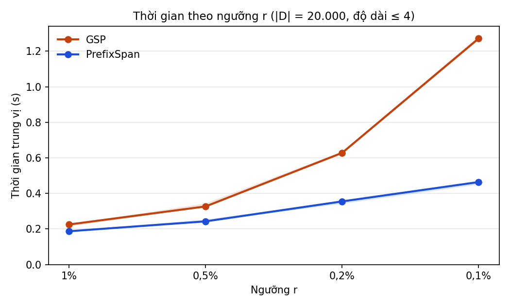
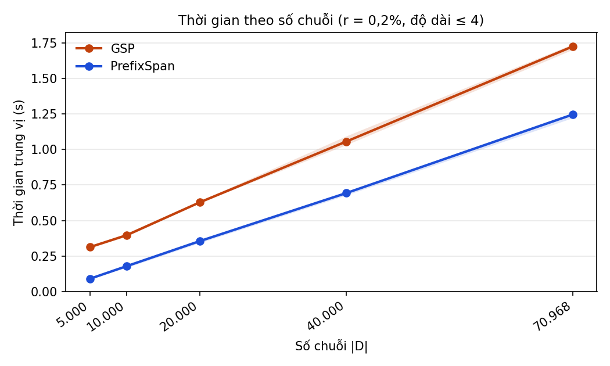
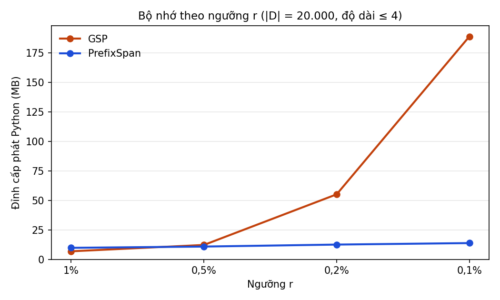
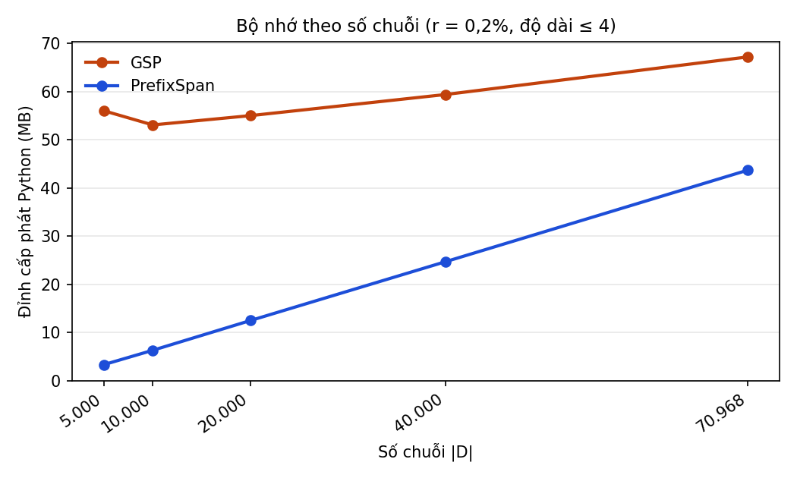

# Ứng dụng 2: Dự đoán trang web truy cập tiếp theo trên dữ liệu Wikispeedia

> **Bản v2 (01/11/2026), đã duyệt và đã có kết quả thực nghiệm.** Bản này sửa từ bản bàn giao theo các quyết định chốt ngày 01/11/2026: (1) tự cài đặt GSP và PrefixSpan bằng Python; (2) có đánh giá hữu ích trên tập test với baseline “trang phổ biến”; (3) đo chính chạy trên máy cục bộ, notebook giao kèm để chạy lại trên Kaggle. Danh sách thay đổi và lý do nằm trong [nhật ký sửa](Nhat-ky-sua-v2.md).
>
> **Cập nhật cùng ngày (lần sửa 2).** Rà lại toàn bộ công thức sau khi đọc toàn văn hai paper thuật toán. Sửa công thức support để không gộp các đường đi trùng nhau. Bổ sung: định nghĩa ⊑, lý do làm tròn lên, số ứng viên của GSP gốc, bổ đề khớp sớm nhất kèm chứng minh, đủ các nhánh của ví dụ PrefixSpan, và công thức cho C(h), chia train/test, Coverage, Hit@k. Chi tiết ở mục 5 của nhật ký sửa.
>
> **Lần sửa 3 (01/11/2026): điền kết quả.** Bản nội dung được duyệt; tập dữ liệu, code, bốn lớp kiểm tra tính đúng, phép đo và đánh giá trên tập test đã chạy trên máy cục bộ. Kết quả nằm ở các mục 2.7, 3.7, 4.8, 5.3, 5.9, 5.10 và 6.7. Code, dữ liệu đã chuẩn bị, kết quả thô và notebook Kaggle nằm trong thư mục [thuc-nghiem](thuc-nghiem/). Phần thiết kế không thay đổi so với bản đã duyệt.

Tài liệu trình bày đầy đủ bài toán, dữ liệu, cách áp dụng GSP và PrefixSpan, cách sử dụng mẫu và thiết kế thực nghiệm. Nội dung được viết để đọc hiểu và dùng làm nguồn xây dựng bài trình bày.

Wikispeedia đã được chọn làm dataset. Khảo sát cấu trúc dữ liệu đã hoàn thành. Những thống kê khảo sát được phân biệt với ví dụ minh họa và kết quả khai phá. Thiết kế được chốt và duyệt trước khi chuẩn bị dữ liệu và viết code; sau đó thực nghiệm chạy đúng theo thiết kế này, kết quả được điền vào các mục tương ứng.

Quy ước đọc tài liệu: **[Nguồn]** là phát biểu có tài liệu gốc; **[Khảo sát]** là số liệu tự tính từ dữ liệu gốc trong bước khảo sát chọn dataset; **[Minh họa]** là ví dụ tự dựng để tính tay; **[Thiết kế]** là lựa chọn của bài, chưa phải phương pháp được công bố; **[Kết quả]** là số đo hoặc đầu ra của thực nghiệm do bài chạy trên máy cục bộ ngày 01/11/2026. Các nhãn được đặt ở những chỗ dễ nhầm, không lặp ở mọi câu.

## 1. Bài toán và ý nghĩa của ứng dụng

### 1.1. Bài toán xuất phát từ hành vi điều hướng

Khi sử dụng một website, người dùng thường ghé nhiều trang theo một thứ tự. Trang đang xem và các trang đã ghé trước đó tạo thành lịch sử điều hướng. Thứ tự này mang thông tin mà một tập hợp trang không có thứ tự sẽ làm mất đi.

Ví dụ, hai lịch sử `North America → United States` và `United States → North America` cùng chứa hai trang, nhưng trạng thái hiện tại và hướng di chuyển khác nhau. Ở lịch sử đầu, người dùng đang ở trang United States; ở lịch sử sau, họ đang ở North America. Một chức năng gợi ý cần phân biệt được hai tình huống này.

Ứng dụng Next Website Page Prediction sử dụng lịch sử quan sát được để đưa ra các trang có thể được ghé ngay tiếp theo. Trong bài này, bằng chứng để xây dựng gợi ý được lấy từ các mẫu chuỗi phổ biến và những chuyển tiếp đã quan sát trong dữ liệu.

### 1.2. Đầu vào và đầu ra

Đầu vào là lịch sử có thứ tự:

\[
H=\langle p_1,p_2,\ldots,p_t\rangle,
\]

trong đó mỗi \(p_i\) là một trang bài viết và \(p_t\) là trang được ghé gần nhất. Hệ thống chỉ sử dụng phần lịch sử đã quan sát, không nhìn trước lượt tiếp theo.

Đầu ra dự kiến là tối đa ba trang ứng viên, được xếp hạng và kèm bằng chứng. Một gợi ý có thể cho biết nó được hỗ trợ bởi mẫu nào, ngữ cảnh nào trong lịch sử hiện tại và bao nhiêu chuyển tiếp trực tiếp đã được quan sát. Khi thiếu bằng chứng, hệ thống có thể không đưa ra gợi ý.

Ví dụ minh họa:

```text
Lịch sử hiện tại: North America → United States
Trang ứng viên:   President of the United States
Bằng chứng:       mẫu phù hợp và các chuyển tiếp quan sát được
```

Đây là cách mô tả đầu vào–đầu ra, chưa phải một gợi ý được xác nhận từ kết quả chạy thuật toán.

### 1.3. Vì sao khai phá mẫu chuỗi phù hợp?

Khai phá mẫu chuỗi tìm những hành vi xuất hiện có thứ tự trong nhiều đường đi. Chẳng hạn, một mẫu có thể cho thấy các trang A, B và C thường được ghé theo thứ tự A trước B, B trước C. Mẫu được đánh giá theo số đường đi chứa nó, thay vì chỉ đếm một trang xuất hiện bao nhiêu lần.

Điều này phù hợp với dữ liệu điều hướng vì thông tin cần phân tích chính là thứ tự các lượt ghé. Một thống kê trang phổ biến có thể cho biết trang nào được nhiều người ghé, còn mẫu chuỗi bổ sung thông tin về những trang thường xuất hiện trước hoặc sau nhau trong lịch sử.

Tuy nhiên, mẫu phổ biến mới chỉ là bằng chứng về hành vi đã xảy ra. Để gợi ý lượt ngay tiếp theo, cần quy định cách chọn mẫu phù hợp với lịch sử hiện tại và kiểm tra các chuyển tiếp trực tiếp. Phần 4 giải thích bước này.

### 1.4. Vai trò của GSP và PrefixSpan

GSP và PrefixSpan cùng giải bài toán tìm mẫu chuỗi phổ biến. Chúng khác cách tìm kiếm, nhưng dưới cùng điều kiện khai phá đầy đủ phải tìm được cùng tập mẫu và support. Vì vậy, ứng dụng tạo ra một bối cảnh cụ thể để so sánh chi phí tính toán của hai cách tiếp cận.

Câu hỏi thực nghiệm chính là: **khi cùng khai phá một cơ sở dữ liệu chuỗi, GSP và PrefixSpan khác nhau thế nào về thời gian và bộ nhớ khi ngưỡng support giảm hoặc quy mô dữ liệu tăng?**

Việc sử dụng mẫu để gợi ý trang là bước chung sau khai phá. Nếu hai nhánh cho cùng tập mẫu và sử dụng cùng quy tắc gợi ý, cùng lịch sử phải dẫn tới cùng kết quả gợi ý. Do đó, độ chính xác dự đoán không dùng để phân biệt hai thuật toán.

Bài vẫn có một câu hỏi thứ hai, tách riêng với câu hỏi trên: **chức năng gợi ý dựa trên mẫu có hữu ích hơn một cách gợi ý đơn giản không?** Câu hỏi này được trả lời bằng tập test giữ lại và baseline “trang phổ biến” (mục 5.10). Nó đánh giá ứng dụng, không đánh giá thuật toán nào khai phá nhanh hơn.

### 1.5. Ý nghĩa ứng dụng và phạm vi

Một chức năng gợi ý dựa trên lịch sử có thể hỗ trợ người dùng khám phá các bài viết hoặc giúp người phân tích nhận diện những đường đi lặp lại. Đầu ra có bằng chứng còn giúp giải thích vì sao một trang được đề xuất.

Trong phạm vi bài, giá trị này được kiểm tra ở mức offline: gợi ý có chứa đúng trang người chơi ghé tiếp theo trong tập test hay không, so với baseline. Kết quả offline không chứng minh chức năng giúp người dùng tìm thông tin nhanh hơn hoặc tăng tương tác; muốn khẳng định điều đó cần thử nghiệm với người dùng thật. Thí nghiệm GSP–PrefixSpan trả lời câu hỏi về chi phí khai phá trên các cấu hình đã đo.

## 2. Dữ liệu Wikispeedia và cách biểu diễn chuỗi

### 2.1. Nguồn gốc và bối cảnh thu thập

Wikispeedia là trò chơi điều hướng trên một phiên bản Wikipedia thu gọn. Người chơi được giao một bài viết xuất phát và một bài viết đích, rồi di chuyển bằng các liên kết giữa bài viết. Dataset ghi lại các đường đi đó, gồm cả lượt chơi hoàn thành và lượt dừng trước khi tới đích. [Stanford SNAP — Wikispeedia navigation paths](https://snap.stanford.edu/data/wikispeedia.html). Trang SNAP liệt kê hai công trình nguồn của dataset: West & Leskovec (2012) và West, Pineau & Precup (2009); bài trích dẫn hai công trình này khi dùng dữ liệu (xem danh mục tham khảo).

Đơn vị quan sát là một lượt chơi có một đường đi. Một người có thể chơi nhiều lượt. Mã IP đã băm trong tệp không phải định danh cá nhân được xác minh, nên không diễn giải số mã này thành số người dùng duy nhất.

Bối cảnh trò chơi cần được giữ trong mọi kết luận: hành vi có mục tiêu tìm đích có thể khác hành vi đọc bài tự do. Dataset thích hợp để nghiên cứu điều hướng, nhưng không tự đại diện cho mọi loại sử dụng Wikipedia.

### 2.2. Các tệp và trường thông tin liên quan

| Tệp | Nội dung | Vai trò trong nghiên cứu |
|---|---|---|
| `paths_finished.tsv` | Đường đi hoàn thành; mã IP băm, thời điểm, thời lượng, path và rating | Lấy chuỗi trang đã ghé. |
| `paths_unfinished.tsv` | Đường đi chưa hoàn thành; có thêm trang đích và loại kết thúc | Lấy chuỗi trang đã ghé; mô tả timeout/restart. |
| `articles.tsv` | Danh mục tên bài viết | Kiểm tra trang hợp lệ và xây ánh xạ tên–mã. |
| `categories.tsv` | Các danh mục phân cấp của bài viết | Có thể hỗ trợ diễn giải; không dùng làm item trong phương án đã chọn. |
| `links.tsv` | Các liên kết giữa bài viết | Thông tin phụ về cấu trúc website; không thay thế lịch sử truy cập. |

Trường `path` là đầu vào chính. Các trang được ngăn cách bằng dấu chấm phẩy; tên trang được mã hóa URL; ký hiệu `<` biểu diễn thao tác quay lại.

Timestamp mô tả thời điểm của lượt chơi và duration mô tả thời lượng chung. Tệp không cung cấp thời điểm riêng cho từng click, nên không suy ra thời gian dừng ở từng trang hoặc tự đặt điều kiện khoảng cách thời gian giữa mọi lượt ghé.

Rating là đánh giá tùy chọn của người chơi, không phải nhãn đúng/sai của trang tiếp theo. Trường này không cần cho khai phá chuỗi, nên rating bị thiếu không phải lý do để loại một đường đi hợp lệ.

Trang đích trong tệp chưa hoàn thành có thể là trang người chơi chưa hề ghé. Không nối nó vào cuối đường đi, vì việc đó sẽ tạo thêm hành vi không được quan sát. Thiết kế hiện tại cũng không sử dụng trang đích làm đầu vào gợi ý.

### 2.3. Quy mô gốc và kết quả khảo sát

| Chỉ số | Số lượng |
|---|---:|
| Đường đi hoàn thành | 51.318 |
| Đường đi chưa hoàn thành | 24.875 |
| Tổng đường đi | 76.193 |
| Bài viết trong danh mục | 4.604 |
| Bài viết thực sự xuất hiện trong toàn bộ đường đi | 4.182 |
| Tổng lượt ghé sau khi diễn giải thao tác quay lại | 476.073 |
| Độ dài trung bình | Khoảng 6,25 lượt |
| Độ dài trung vị | 5 lượt |
| Đường đi có ít nhất 4 lượt | 60.358, tương đương 79,22% |
| Đường đi ghé ít nhất hai trang khác nhau | 70.968, tương đương 93,14% |
| Đường đi chứa thao tác quay lại | 14.196, tương đương 18,63% |

Số đường đi và số bài trong danh mục được công bố bởi SNAP. Các thống kê về trang xuất hiện, độ dài, lượt ghé và thao tác quay lại được tính trực tiếp trong khảo sát của bài này. [Báo cáo khảo sát](../Ban-giao-Wikispeedia-2026-11-01/03_Khao_sat/Khao-sat-va-de-xuat-chon-dataset.md), [số liệu chi tiết](../Ban-giao-Wikispeedia-2026-11-01/03_Khao_sat/structure_statistics.json).

4.604 là số bài viết của website thu gọn, còn 4.182 là số bài thật sự có trong các đường đi được ghi nhận. Hai con số có ý nghĩa khác nhau. Tương tự, độ dài trung vị 5 có nghĩa ít nhất một nửa đường đi dài không quá 5 lượt và ít nhất một nửa dài từ 5 lượt trở lên; không có nghĩa phần lớn đường đi dài đúng 5.

Mười trang được ghé nhiều nhất chỉ chiếm khoảng 10,67% tổng lượt ghé. Số chuỗi chứa một trang có trung vị 36; có 465 trang xuất hiện trong không quá 10 chuỗi. Những thống kê này cho thấy hành vi phân tán ở mức trang cụ thể. Vì vậy, chọn support quá cao có thể chỉ giữ các mẫu liên quan đến một số ít trang phổ biến.

### 2.4. Vì sao dữ liệu này phù hợp với bài?

Thứ nhất, mỗi sự kiện có danh tính trang cụ thể. Có thể giải mã mẫu thành tên bài viết và giải thích gợi ý ở đúng mức “trang tiếp theo”.

Thứ hai, phần lớn đường đi chứa nhiều trang. Dữ liệu cho phép thể hiện tác dụng của lịch sử nhiều bước và sự khác nhau giữa các thứ tự truy cập.

Thứ ba, quy mô đủ để xây các tập con phục vụ khảo sát khả năng mở rộng. Sau điều kiện tối thiểu hai lượt còn 70.968 chuỗi (mục 2.7). Số này cho phép thiết kế nhiều mức dữ liệu từ 5.000 chuỗi tới toàn bộ tập.

Thứ tư, dữ liệu có thể biểu diễn trực tiếp thành cơ sở dữ liệu chuỗi. Không cần xây đặc trưng ảnh hoặc văn bản để áp dụng hai thuật toán. Phần quan trọng là giữ đúng ngữ nghĩa đường đi.

### 2.5. Item, event và sequence

Một **item** là một trang bài viết. Khi triển khai, mỗi trang sẽ được gán một mã nhất quán và có ánh xạ ngược để đọc kết quả.

Một **event** là một lượt ghé trang. Trong ứng dụng này, mỗi event chứa một item, vì một vị trí trong lịch sử tương ứng một trang. Biểu diễn bằng itemset đơn vẫn phù hợp với đầu vào dạng chuỗi itemset của GSP và PrefixSpan.

Một **sequence** là toàn bộ các event của một lượt chơi theo thứ tự. **Sequence database** là tập các sequence được chọn cho một lần khai phá.

Ví dụ minh họa:

```text
Tên trang: North America → United States → President of the United States
Ký hiệu:   A → B → C
Biểu diễn: ⟨{A}, {B}, {C}⟩
```

Không gom ba trang thành một itemset `{A,B,C}`, vì cách đó biểu diễn một nhóm không có thứ tự. Độ dài chuỗi là số lượt ghé, không phải số trang khác nhau. Chẳng hạn, `A → B → A` dài 3 và chứa 2 trang khác nhau.

### 2.6. Khôi phục thao tác quay lại

Ký hiệu `<` là một hành động, không phải tên trang. Để chuyển sang chuỗi lượt ghé, cần xác định trang mà người chơi quay về.

Ví dụ thật trong tệp chưa hoàn thành:

```text
Potato;Europe;North_America;<;<
```

Đường đi bắt đầu ở Potato, tới Europe, rồi North America. Lần quay lại thứ nhất đưa người chơi về Europe; lần thứ hai đưa về Potato. Lịch sử lượt ghé tương ứng là:

```text
Potato → Europe → North America → Europe → Potato
```

Có thể hình dung một ngăn xếp lưu nhánh lịch sử hiện tại: đi tới trang mới thì thêm trang, quay lại thì bỏ trang hiện tại và lấy trang trước đó. Mỗi lần quay về vẫn được ghi thêm vào lịch sử lượt ghé. Ngăn xếp dùng xác định vị trí hiện tại; lịch sử lượt ghé dùng làm dữ liệu chuỗi.

Nếu chỉ xóa `<`, hai lượt quay về sẽ mất. Nếu chỉ lấy ngăn xếp còn lại sau cùng, phần lịch sử đã đi qua cũng mất. Cả hai cách đều thay đổi dữ liệu cần nghiên cứu.

Trong khảo sát, toàn bộ thao tác quay lại đã diễn giải được, không gặp trường hợp quay lại vượt quá lịch sử. Sau khôi phục, không có hai trang liền kề giống nhau, nhưng 19,89% đường đi vẫn ghé lại một trang ở vị trí xa hơn. Vì vậy, không diễn giải thống kê này thành “dữ liệu không có lặp”.

Khi tạo tập thực nghiệm, mỗi lượt ghé được gắn thêm một cờ cho biết nó đến từ click tiến hay từ thao tác quay lại. Cờ này không đưa vào thuật toán khai phá; nó chỉ dùng khi đánh giá để tách riêng các lượt tiến (mục 5.10), vì trang đến sau một lần quay lại là trang đã có trong lịch sử và dễ đoán hơn.

### 2.7. Các nguyên tắc chọn và giữ dữ liệu

Bài dùng cả đường đi hoàn thành và chưa hoàn thành. Một lượt chưa tới đích vẫn chứa các hành vi thật đã được ghi nhận. Chỉ dùng lượt thành công sẽ thay đổi đối tượng nghiên cứu sang hành vi điều hướng thành công.

Đề xuất giữ các chuỗi có ít nhất hai lượt vì chúng có ít nhất một chuyển tiếp để phân tích. Khảo sát cho biết điều kiện này giữ 70.968 chuỗi và loại 5.225 chuỗi một lượt.

**[Kết quả] Tập thực nghiệm đã tạo.** Tập được đọc thẳng từ archive gốc của SNAP (SHA-256 bắt đầu bằng `97697096`), không giải nén ra đĩa, bằng hàm `prepare` trong `thuc-nghiem/spm_wiki.py`.

| Chỉ số | Giá trị |
|---|---:|
| Đường đi gốc (hoàn thành + chưa hoàn thành) | 76.193 (51.318 + 24.875) |
| Đường đi có thao tác quay lại không diễn giải được | 0 |
| Chuỗi một lượt bị loại | 5.225 |
| Chuỗi được giữ, \|D\| | 70.968 |
| Tổng lượt ghé | 470.848 |
| Lượt ghé đến từ thao tác quay lại | 33.468 (7,11%) |
| Số trang khác nhau | 4.179 |
| Độ dài trung bình / dài nhất | 6,63 / 435 lượt |
| Train / test (⌊0,8·\|D\|⌋ / phần còn lại) | 56.774 / 14.194 chuỗi |

Các số này khớp với khảo sát: 76.193 − 5.225 = 70.968 chuỗi, và 476.073 − 5.225 = 470.848 lượt ghé. Số trang là 4.179 thay vì 4.182 vì có 3 trang chỉ xuất hiện trong chuỗi một lượt. Các chuỗi được xáo trộn một lần bằng seed 20261101; mọi tập con và phép chia train/test đều lấy theo thứ tự này.

Giữ thứ tự, các lần ghé lại và các đường đi có cùng giá trị. Nhiều lượt chơi có thể đi cùng một lộ trình; đó chính là dạng lặp mà khai phá mẫu cần quan sát. Không tự xem những đường đi giống nhau là bản ghi lỗi. Cũng không nối các lượt chơi có cùng mã IP thành một sequence, vì mỗi lượt có ranh giới và bối cảnh riêng.

Sau khi lọc, phải thống kê lại số trang xuất hiện, độ dài và support. Khi mẫu số đổi từ 76.193 sang 70.968, support của một mẫu có thể đổi dù số đường đi chứa mẫu không đổi. Các số liệu khảo sát toàn bộ dữ liệu không được mặc định là thống kê của tập sau lọc.

## 3. Áp dụng GSP và PrefixSpan để khai phá mẫu

### 3.1. Mẫu chuỗi và quan hệ chuỗi con

Xét chuỗi các trang \(S=\langle s_1,\ldots,s_n\rangle\) và mẫu \(P=\langle q_1,\ldots,q_k\rangle\). P là **chuỗi con** của S, ký hiệu \(P\sqsubseteq S\), nếu tồn tại các chỉ số

\[
1\le i_1<i_2<\cdots<i_k\le n
\quad\text{sao cho}\quad
q_j=s_{i_j}\ \ (j=1,\ldots,k).
\]

Khi đó ta cũng nói S **chứa** P. Điều kiện tăng dần giữ thứ tự nhưng cho phép bỏ qua các trang nằm giữa.

Hai paper viết định nghĩa này cho chuỗi itemset: \(\langle a_1a_2\cdots a_k\rangle\sqsubseteq\langle b_1b_2\cdots b_n\rangle\) nếu có \(1\le j_1<\cdots<j_k\le n\) với \(a_1\subseteq b_{j_1},\ldots,a_k\subseteq b_{j_k}\). [Nguồn: Srikant & Agrawal 1996, mục 2; Pei và cộng sự 2004, mục 2.1] Ở bài này mỗi event là itemset đúng một trang, nên \(\{q_j\}\subseteq\{s_{i_j}\}\) tương đương \(q_j=s_{i_j}\). Định nghĩa ở trên là trường hợp riêng của định nghĩa gốc, không phải một định nghĩa mới.

Vì vậy, mẫu `A → B → C` có trong cả `A → B → C` và `A → X → B → C`. Nó không có trong `A → C → B`. Một mẫu có trang lặp cũng cần đủ các lần xuất hiện: `A → A` có trong `A → B → A`, nhưng không có trong chuỗi chỉ chứa một A.

Đây là ngữ nghĩa khai phá chuỗi có khoảng cách được dùng chung cho hai thuật toán. Nó khác với việc chỉ đếm các đoạn liền kề. [Định nghĩa đầu vào và mẫu chuỗi trong SPMF](https://www.philippe-fournier-viger.com/spmf/PrefixSpan.php).

Hai paper và tài liệu này dùng ký hiệu khác nhau cho cùng khái niệm. Bảng sau giúp đối chiếu khi đọc paper:

| Khái niệm | Tài liệu này | GSP (1996) | PrefixSpan (2004) |
|---|---|---|---|
| Cơ sở dữ liệu chuỗi | \(D\) | \(\mathcal D\) (các data-sequence) | \(S\) (tập các bộ \(\langle sid,s\rangle\)) |
| Một chuỗi dữ liệu | \(S\), \(S_1,\ldots,S_5\) | \(d\) | \(s\) |
| Quan hệ chuỗi con | \(P\sqsubseteq S\) | “d contains s” | \(\alpha\sqsubseteq\beta\) |
| Support | \(\operatorname{sup}_D(P)\), số chuỗi | “support”; mục 2 gọi là tỷ lệ, phần tóm tắt gọi là số chuỗi | \(\mathrm{support}_S(\alpha)\), số bộ |
| Ngưỡng | \(\operatorname{min\_sup}\), số nguyên | minimum support | min_support, số nguyên dương |

Cần chú ý: paper PrefixSpan dùng chữ S cho **cơ sở dữ liệu**, còn tài liệu này dùng S cho **một chuỗi** và D cho cơ sở dữ liệu.

### 3.2. Support và ngưỡng min_sup

Để thống nhất với phần lý thuyết chung của nhóm (Content-v4), **support là số đếm tuyệt đối**: số chuỗi trong cơ sở dữ liệu D chứa P.

Cơ sở dữ liệu được viết thành tập các cặp (mã chuỗi, chuỗi), giống cách viết của paper PrefixSpan:

\[
D=\{(\mathit{sid}_1,S_1),\ldots,(\mathit{sid}_N,S_N)\},\qquad |D|=N,
\]

\[
\operatorname{sup}_D(P)=\bigl|\{(\mathit{sid},S)\in D:\ P\sqsubseteq S\}\bigr|,
\qquad
\operatorname{rsup}_D(P)=\frac{\operatorname{sup}_D(P)}{|D|}.
\]

[Nguồn: Pei và cộng sự 2004, mục 2.1, định nghĩa \(\mathrm{support}_S(\alpha)\)]

Mã chuỗi là bắt buộc. Nhiều lượt chơi có thể đi đúng cùng một lộ trình, và các đường đi trùng nhau được giữ lại (mục 2.7). Nếu viết \(\{S\in D: P\sqsubseteq S\}\) như một tập các chuỗi, các đường đi giống hệt nhau sẽ bị gộp làm một. Ngay trong ví dụ ở mục 3.3, S1 và S3 cùng là ⟨A,B,C⟩: đếm theo tập chuỗi cho sup(⟨A,B⟩) = 3, còn đếm theo cặp (mã, chuỗi) cho đúng 4.

rsup là **support tương đối**, dùng khi cần so sánh giữa các tập có kích thước khác nhau. Một chuỗi đóng góp tối đa một lần vào sup, dù chứa nhiều cách khớp mẫu. Cách đếm theo chuỗi giúp một đường đi dài, lặp nhiều lần không tự đóng góp như nhiều lượt chơi độc lập.

Trong thực nghiệm, ngưỡng được nhập dưới dạng tỷ lệ r (ví dụ 0,2%) rồi đổi thành ngưỡng đếm:

\[
\operatorname{min\_sup}=\lceil r\cdot|D|\rceil,
\qquad
P \text{ phổ biến} \iff \operatorname{sup}_D(P)\ge \operatorname{min\_sup}.
\]

**Vì sao làm tròn lên?** sup là số nguyên, và với số nguyên x thì \(x\ge a \iff x\ge\lceil a\rceil\). Do đó, với mọi r > 0:

\[
\operatorname{sup}_D(P)\ge\lceil r\cdot|D|\rceil
\iff \operatorname{sup}_D(P)\ge r\cdot|D|
\iff \operatorname{rsup}_D(P)\ge r .
\]

Ngưỡng đếm và ngưỡng tỷ lệ vì thế chọn ra đúng cùng một tập mẫu. Làm tròn xuống hoặc làm tròn gần nhất có thể nhận cả mẫu có rsup < r.

**Về dấu so sánh.** Paper PrefixSpan định nghĩa mẫu phổ biến bằng \(\mathrm{support}_S(\alpha)\ge\) min_support, với min_support là số nguyên dương. [Nguồn: Pei và cộng sự 2004, mục 2.1] Paper GSP diễn đạt khác: mục 2.1 viết support “greater than” minimum support, còn mục 2 gọi support là tỷ lệ chuỗi trong khi phần tóm tắt gọi là số chuỗi. [Nguồn: Srikant & Agrawal 1996, tóm tắt, mục 2 và 2.1] Tài liệu này theo định nghĩa của PrefixSpan: support là số đếm và dùng dấu ≥. Cả hai bản cài đặt dùng chung định nghĩa này, nên khác biệt diễn đạt của paper GSP không ảnh hưởng tới phép so sánh.

Chẳng hạn, r = 0,2% trên 20.000 chuỗi cho min_sup = 40 chuỗi; r = 0,1% trên cùng tập cho 20 chuỗi. Phép làm tròn lên được tính bằng số nguyên/phân số chính xác, không bằng số thực dấu phẩy động, để tránh lỗi làm tròn. Ví dụ, trong Python phép nhân số thực 0,07 × 100 cho 7,000000000000001, nên làm tròn lên thành 8 thay vì 7. Cùng một hàm đổi ngưỡng được dùng cho cả hai thuật toán. Khi ghi kết quả, luôn ghi kèm cả r, |D| và min_sup để người đọc không phải tự đổi đơn vị.

Khi tỷ lệ r giảm trên cùng dữ liệu và cùng giới hạn độ dài, tập mẫu phổ biến có thể mở rộng và số mẫu không giảm. Điều này tạo một trục thực nghiệm để xem hai thuật toán xử lý mức khai phá rộng hơn ra sao.

### 3.3. Bộ dữ liệu minh họa dùng xuyên suốt

Các chuỗi dưới đây được dựng để giải thích và tính tay. Chúng không phải các lượt chơi trích xuất từ Wikispeedia.

| Ký hiệu | Tên trang dùng để hình dung |
|---|---|
| A | North America |
| B | United States |
| C | President of the United States |
| D | Canada |
| X | Europe |

| Chuỗi | Lịch sử minh họa |
|---|---|
| S1 | ⟨A, B, C⟩ |
| S2 | ⟨A, X, B, C⟩ |
| S3 | ⟨A, B, C⟩ |
| S4 | ⟨A, B, D⟩ |
| S5 | ⟨B, C⟩ |

Chọn r = 40% cho ví dụ, tức min_sup = ⌈0,4 × 5⌉ = 2 chuỗi. A xuất hiện trong 4 chuỗi; B trong 5; C trong 4; D và X chỉ trong 1 chuỗi mỗi item. Do đó A, B, C là các mẫu một item phổ biến.

### 3.4. GSP xử lý ví dụ như thế nào?

GSP khai phá theo mức độ dài và quét lại toàn bộ dữ liệu ở mỗi mức. Lượt quét đầu tìm các item phổ biến. Mỗi lượt sau lấy các mẫu phổ biến của mức trước làm “hạt giống”, sinh ứng viên dài hơn một item, rồi quét dữ liệu một lần để đếm support của mọi ứng viên. Thuật toán dừng khi không còn ứng viên hoặc không còn mẫu phổ biến mới. [Nguồn: Srikant & Agrawal 1996, mục 3]

Gọi \(L_k\) là tập mẫu phổ biến độ dài k và \(C_k\) là tập ứng viên độ dài k. Ứng viên \(C_k\) được sinh từ \(L_{k-1}\) qua hai pha. [Nguồn: Srikant & Agrawal 1996, mục 3.1] Với chuỗi một item mỗi event, hai pha viết được như sau.

**Pha nối (join).** Hai mẫu \(s_1=\langle x_1,\ldots,x_{k-1}\rangle\) và \(s_2=\langle y_1,\ldots,y_{k-1}\rangle\) thuộc \(L_{k-1}\) được nối nếu bỏ item đầu của s₁ thì được đúng chuỗi bỏ item cuối của s₂. Ứng viên mới là s₁ thêm item cuối của s₂:

\[
\langle x_2,\ldots,x_{k-1}\rangle=\langle y_1,\ldots,y_{k-2}\rangle
\;\Longrightarrow\;
\langle x_1,x_2,\ldots,x_{k-1},y_{k-1}\rangle\in C_k .
\]

s₁ được phép nối với chính nó. Ở mức 2, cả hai vế của điều kiện đều là chuỗi rỗng, nên mọi cặp item phổ biến (a, b) đều nối được, kể cả a = b.

**Pha cắt tỉa (prune).** Loại ứng viên có một chuỗi con độ dài k−1 không thuộc \(L_{k-1}\). Paper gốc phân biệt hai trường hợp: có ràng buộc max-gap thì chỉ kiểm tra các chuỗi con *contiguous*; không có max-gap thì kiểm tra mọi chuỗi con. Bài này không dùng max-gap, nên kiểm tra mọi chuỗi con độ dài k−1, tức lần lượt bỏ từng vị trí của ứng viên.

**Lưu ý thuật ngữ “contiguous”.** Paper GSP định nghĩa contiguous subsequence bằng cách bỏ một item ở event đầu, ở event cuối, hoặc ở một event có từ hai item trở lên, rồi lặp lại. [Nguồn: Srikant & Agrawal 1996, mục 3.1] Với chuỗi một item mỗi event, định nghĩa này cho ra đúng các đoạn nằm liền nhau **trong chính mẫu**. Riêng chuỗi con độ dài k−1 thì chỉ có hai: bỏ item đầu và bỏ item cuối. Đây là vị trí bên trong mẫu, không phải điều kiện các trang phải liền kề trong đường đi dữ liệu. Phần 4 dùng chữ “liền kề” theo nghĩa liền kề trong đường đi; hai khái niệm không được trộn. Tài liệu giữ nguyên chữ contiguous khi nói về GSP.

**Cơ sở của cắt tỉa: tính chất Apriori.** Quan hệ ⊑ có tính bắc cầu: nếu P′ ⊑ P và P ⊑ S thì P′ ⊑ S. Vì vậy mọi chuỗi chứa P đều chứa P′, tức tập mã chuỗi chứa P là tập con của tập mã chuỗi chứa P′:

\[
P'\sqsubseteq P \;\Longrightarrow\; \operatorname{sup}_D(P)\le\operatorname{sup}_D(P').
\]

Nếu một chuỗi con P′ đã có \(\operatorname{sup}_D(P')<\operatorname{min\_sup}\) thì mọi P chứa nó cũng có \(\operatorname{sup}_D(P)<\operatorname{min\_sup}\), nên P bị loại mà không cần đếm.

Trong ví dụ, mức 2 có 3 × 3 = 9 ứng viên từ A, B, C. Ở mức 2, pha cắt tỉa không loại được ứng viên nào: chuỗi con độ dài 1 của ⟨a,b⟩ là ⟨a⟩ và ⟨b⟩, vốn đã phổ biến. Vì vậy cả 9 ứng viên đều phải đếm trên dữ liệu. Đếm trên năm chuỗi, ba ứng viên phổ biến:

| Mẫu | Chuỗi hỗ trợ | sup (số chuỗi) | rsup |
|---|---|---:|---:|
| ⟨A, B⟩ | S1, S2, S3, S4 | 4 | 80% |
| ⟨A, C⟩ | S1, S2, S3 | 3 | 60% |
| ⟨B, C⟩ | S1, S2, S3, S5 | 4 | 80% |

Các mẫu có D hoặc X không được sinh ra vì D, X không phổ biến. Sáu ứng viên còn lại như ⟨B,A⟩, ⟨C,B⟩ hay ⟨A,A⟩ đã được sinh và đếm nhưng đều có sup = 0: không chuỗi nào chứa B trước A, C trước B hoặc hai lần A. Đây chính là phần “sinh rồi kiểm tra” tốn công của GSP.

**Số ứng viên mức 2 của GSP gốc lớn hơn.** Con số 9 ở trên là số ứng viên khi chỉ mở rộng chuỗi. GSP gốc làm việc với chuỗi itemset. Khi nối \(L_1\) với \(L_1\), nó còn thêm item của s₂ vào **cùng event** với item của s₁, tạo các ứng viên dạng ⟨(a b)⟩ với a < b. [Nguồn: Srikant & Agrawal 1996, mục 3.1] Với n item phổ biến:

\[
|C_2|_{\text{GSP gốc}}=n^2+\binom{n}{2}=n^2+\frac{n(n-1)}{2},
\qquad
|C_2|_{\text{chỉ mở rộng chuỗi}}=n^2 .
\]

Paper PrefixSpan minh họa đúng công thức thứ nhất: 6 item phổ biến sinh 6 × 6 + 6 × 5/2 = 51 ứng viên độ dài 2. [Nguồn: Pei và cộng sự 2004, mục 2.2, Ví dụ 2] Trong ví dụ của bài, GSP gốc có 9 + 3 = 12 ứng viên. Ba ứng viên ⟨(A B)⟩, ⟨(A C)⟩, ⟨(B C)⟩ chắc chắn có sup = 0, vì mỗi event chỉ chứa một trang. Bài bỏ hẳn loại ứng viên này (mục 3.7), nên mọi số ứng viên trong tài liệu và trong bảng kết quả đều tính theo cách chỉ mở rộng chuỗi.

Ở mức 3, pha nối chỉ ghép được một cặp. Bỏ item đầu của ⟨A,B⟩ được ⟨B⟩, đúng bằng ⟨B,C⟩ bỏ item cuối, nên hai mẫu nối thành ⟨A,B,C⟩. Các cặp khác không thỏa điều kiện; chẳng hạn ⟨A,C⟩ bỏ item đầu còn ⟨C⟩, nhưng không mẫu nào trong \(L_2\) bắt đầu bằng C. Ba chuỗi con hai item của ⟨A,B,C⟩ là ⟨A,B⟩, ⟨A,C⟩, ⟨B,C⟩, đều phổ biến nên ứng viên được giữ. Đếm trên dữ liệu được sup = 3, rsup = 60%. S2 vẫn hỗ trợ mẫu dù có X nằm giữa A và B. Ở mức 4, \(L_3=\{\langle A,B,C\rangle\}\) chỉ có một mẫu; bỏ item đầu được ⟨B,C⟩ nhưng không mẫu nào trong \(L_3\) bắt đầu bằng ⟨B,C⟩. Không còn ứng viên, thuật toán dừng.

Để đếm support, paper gốc đặt ứng viên vào một hash tree, rồi với mỗi chuỗi dữ liệu chỉ kiểm tra những ứng viên có thể nằm trong chuỗi đó. [Nguồn: Srikant & Agrawal 1996, mục 3.2] Bản cài đặt của bài dùng một cây tiền tố ứng viên với cùng vai trò (mục 3.7).

Chi phí của GSP liên quan đến số ứng viên cần sinh, lưu và kiểm tra. Với Wikispeedia, ước lượng từ khảo sát trên toàn bộ 76.193 đường đi cho thấy có 579 trang đạt r = 0,2% (min_sup = ⌈0,002 × 76.193⌉ = 153) và 1.123 trang đạt r = 0,1% (min_sup = 77). Nếu chỉ mở rộng chuỗi, mức 2 cần 579² = 335.241 và 1.123² = 1.261.129 ứng viên. GSP gốc còn sinh thêm ứng viên cùng event, thành 502.572 và 1.891.132. [Khảo sát, ước lượng trên toàn bộ dữ liệu; tập thực nghiệm sau lọc và tập train sẽ có số khác] Đây là lý do phải chạy thử khả năng hoàn thành trước khi chốt dải cấu hình.

### 3.5. PrefixSpan xử lý cùng ví dụ như thế nào?

PrefixSpan mở rộng các tiền tố. Với một tiền tố, thuật toán tập trung vào các phần của đường đi nằm sau vị trí khớp tiền tố, gọi là cơ sở dữ liệu chiếu. Những item đủ phổ biến trong các phần này được dùng để mở rộng mẫu. Thuật toán không sinh tập ứng viên toàn cục: chỉ những item thật sự xuất hiện trong dữ liệu chiếu mới được đếm. [Nguồn: Pei và cộng sự 2004, mục 3.2, Thuật toán 1]

Paper định nghĩa tiền tố, hậu tố và cơ sở dữ liệu chiếu cho chuỗi itemset. [Nguồn: Pei và cộng sự 2004, mục 3.2, Định nghĩa 1–4, Bổ đề 3.2] Với chuỗi một item mỗi event, các khái niệm này viết gọn như sau. Ký hiệu \(\alpha\cdot\langle y\rangle\) là mẫu α thêm item y vào cuối.

- \(e(\alpha,S)\) là vị trí kết thúc của **lần khớp sớm nhất** của α trong S. Cách khớp này và lý do dùng nó được trình bày ở cuối mục.
- **Hậu tố** của S theo α là phần nằm sau vị trí đó: \(S/\alpha=\langle s_{e(\alpha,S)+1},\ldots,s_n\rangle\). Hậu tố có thể rỗng.
- **Cơ sở dữ liệu chiếu** theo α gồm hậu tố của mọi chuỗi chứa α, giữ kèm mã chuỗi:

\[
D|_{\alpha}=\bigl\{(\mathit{sid},\,S/\alpha):\ (\mathit{sid},S)\in D,\ \alpha\sqsubseteq S\bigr\}.
\]

- Support của mẫu mở rộng đếm được ngay trên dữ liệu chiếu, so với cùng ngưỡng min_sup của toàn bộ D:

\[
\operatorname{sup}_D(\alpha\cdot\langle y\rangle)=\bigl|\{(\mathit{sid},T)\in D|_{\alpha}:\ y \text{ xuất hiện trong } T\}\bigr| .
\]

Đẳng thức cuối là trường hợp riêng, cho event một item, của Bổ đề 3.2 trong paper: support tính trên dữ liệu chiếu bằng support tính trên toàn bộ cơ sở dữ liệu. Nó đúng nhờ hệ quả chứng minh ở cuối mục này.

Xét tiền tố ⟨A⟩ trong ví dụ:

| Chuỗi gốc | Phần sau A |
|---|---|
| S1 | ⟨B,C⟩ |
| S2 | ⟨X,B,C⟩ |
| S3 | ⟨B,C⟩ |
| S4 | ⟨B,D⟩ |

S5 không chứa A nên không đóng góp vào dữ liệu chiếu của tiền tố A. Trong bốn phần còn lại, B xuất hiện ở cả bốn, C ở ba, D và X ở một phần. Với ngưỡng đếm tuyệt đối vẫn là 2, ta có thể mở rộng A thành ⟨A,B⟩ và ⟨A,C⟩.

Tiếp tục với tiền tố ⟨A,B⟩, phần phía sau là C ở S1, S2, S3 và D ở S4. C có 3 chuỗi hỗ trợ, nên tạo mẫu ⟨A,B,C⟩.

Mẫu này có **sup = 3, rsup = 3/5 = 60% trên cơ sở dữ liệu gốc**. Không lấy 3/4 để thay cho rsup chỉ vì cơ sở dữ liệu chiếu hiện có bốn chuỗi. Ngưỡng min_sup = 2 của bài toán không được tự thay đổi theo từng nhánh chiếu.

Toàn bộ quá trình trên ví dụ, gồm cả các nhánh chưa trình bày ở trên:

| Tiền tố α | Dữ liệu chiếu \(D|_{\alpha}\) (hậu tố) | Item đạt min_sup = 2 | Mẫu mới |
|---|---|---|---|
| ⟨A⟩ | S1: ⟨B,C⟩; S2: ⟨X,B,C⟩; S3: ⟨B,C⟩; S4: ⟨B,D⟩ | B (4), C (3) | ⟨A,B⟩, ⟨A,C⟩ |
| ⟨A,B⟩ | S1: ⟨C⟩; S2: ⟨C⟩; S3: ⟨C⟩; S4: ⟨D⟩ | C (3) | ⟨A,B,C⟩ |
| ⟨A,C⟩ | S1, S2, S3: rỗng | không có | — |
| ⟨A,B,C⟩ | S1, S2, S3: rỗng | không có | — |
| ⟨B⟩ | S1: ⟨C⟩; S2: ⟨C⟩; S3: ⟨C⟩; S4: ⟨D⟩; S5: ⟨C⟩ | C (4) | ⟨B,C⟩ |
| ⟨B,C⟩ | S1, S2, S3, S5: rỗng | không có | — |
| ⟨C⟩ | S1, S2, S3, S5: rỗng | không có | — |

Cộng ba mẫu một item ⟨A⟩, ⟨B⟩, ⟨C⟩ từ lượt quét đầu, PrefixSpan tìm đúng 7 mẫu như GSP (mục 3.6). Hậu tố rỗng ứng với ký hiệu `$` trong Bảng 3 của paper: chuỗi có chứa tiền tố nhưng không còn gì để mở rộng. Theo Thuật toán 1 của paper, mỗi mẫu mới lại được chiếu tiếp; các nhánh dừng khi không còn item đạt ngưỡng.

**Vì sao chỉ cần vị trí khớp sớm nhất?** Ví dụ trên có cách khớp đơn giản. Đường đi thật có trang lặp, nên một tiền tố có thể khớp theo nhiều cách. Paper mô tả cách làm cho trường hợp này trong Ví dụ 4: với tiền tố ⟨a⟩, chỉ xét phần sau **lần xuất hiện đầu tiên** của a. [Nguồn: Pei và cộng sự 2004, mục 3.2] Với tiền tố dài hơn, bài dùng **khớp tham lam** từ trái sang. Cho \(\alpha=\langle q_1,\ldots,q_k\rangle\sqsubseteq S\): \(i_1\) là vị trí đầu tiên có \(s_{i_1}=q_1\); với t ≥ 2, \(i_t\) là vị trí đầu tiên sau \(i_{t-1}\) có \(s_{i_t}=q_t\). Đặt \(e(\alpha,S)=i_k\).

*Bổ đề.* Nếu \(\alpha\sqsubseteq S\) thì khớp tham lam tồn tại. Hơn nữa, với mọi cách khớp \(j_1<\cdots<j_k\) của α trong S, ta có \(i_t\le j_t\) với mọi t. Đặc biệt \(e(\alpha,S)\le j_k\): khớp tham lam kết thúc sớm nhất.

*Chứng minh (quy nạp theo t).* Với t = 1: \(i_1\) là vị trí đầu tiên của \(q_1\) nên \(i_1\le j_1\). Giả sử \(i_t\le j_t\). Ta có \(j_{t+1}>j_t\ge i_t\) và \(s_{j_{t+1}}=q_{t+1}\), nên \(j_{t+1}\) là một vị trí sau \(i_t\) chứa \(q_{t+1}\). \(i_{t+1}\) là vị trí đầu tiên như vậy, nên \(i_{t+1}\le j_{t+1}\). Sự tồn tại cũng suy ra từ lập luận này: mỗi bước luôn có ít nhất vị trí \(j_{t+1}\) để chọn. ∎

*Hệ quả.* Với mọi item y:

\[
\alpha\cdot\langle y\rangle\sqsubseteq S
\iff
y \text{ xuất hiện trong } S \text{ ở một vị trí lớn hơn } e(\alpha,S).
\]

Chiều ⇐: nối vị trí của y vào sau khớp tham lam là được một cách khớp của \(\alpha\cdot\langle y\rangle\). Chiều ⇒: một cách khớp của \(\alpha\cdot\langle y\rangle\) đặt α kết thúc tại một vị trí \(j_k\). Theo bổ đề, \(j_k\ge e(\alpha,S)\), và y nằm ở vị trí lớn hơn \(j_k\), nên cũng lớn hơn \(e(\alpha,S)\).

Hệ quả cho hai điều. Thứ nhất, hậu tố sau vị trí khớp sớm nhất chứa mọi khả năng mở rộng, nên không bỏ sót mẫu. Thứ hai, mỗi chuỗi chỉ có một hậu tố trong dữ liệu chiếu, nên không chuỗi nào bị đếm hai lần vào support. Bản GSP của bài cũng dùng khớp tham lam để kiểm tra một chuỗi có chứa ứng viên hay không. Bổ đề và hệ quả đã được kiểm tra thêm bằng code, so với cách liệt kê mọi cách khớp, trên 20.000 cặp (chuỗi, mẫu) ngẫu nhiên. Phép kiểm tra này sẽ được đưa vào notebook.

Paper PrefixSpan đề xuất **pseudo-projection**: thay vì chép phần hậu tố ra thành dữ liệu mới, chỉ lưu cặp (mã chuỗi, vị trí bắt đầu hậu tố). [Nguồn: Pei và cộng sự 2004, mục 3.3] Ví dụ, dữ liệu chiếu của ⟨A⟩ chỉ là bốn cặp (S1, sau vị trí 1), (S2, sau vị trí 1), (S3, sau vị trí 1), (S4, sau vị trí 1). Bản cài đặt của bài dùng cách này vì toàn bộ dữ liệu Wikispeedia nằm vừa trong bộ nhớ.

Bảng 3 của paper có khi lưu nhiều vị trí cho một chuỗi, ví dụ {2, 3, 6}. Nhiều vị trí là cần thiết cho mở rộng itemset, khi item mới phải nằm **cùng event** với item cuối của tiền tố: lần xuất hiện đầu tiên của tiền tố có thể nằm trong một event không chứa item đó. Dữ liệu của bài chỉ có mở rộng chuỗi, và theo hệ quả trên, một vị trí (sau lần khớp sớm nhất) là đủ.

PrefixSpan có thể giảm việc xét ứng viên không tồn tại nhờ chỉ đếm item có trong dữ liệu chiếu. Tuy nhiên, việc tạo và lưu nhiều dữ liệu chiếu cũng có chi phí. Paper gốc báo cáo PrefixSpan nhanh hơn GSP trong hầu hết thí nghiệm của họ, và GSP chỉ chạy tốt khi min_support khá cao. [Nguồn: Pei và cộng sự 2004, mục 4.1] Cùng mục đó có ba chi tiết cần nói kèm:

- Bản GSP trong thí nghiệm do chính nhóm tác giả PrefixSpan tự cài bằng C++, theo mô tả của paper GSP.
- Kết quả không tuyệt đối. Trong thử nghiệm khả năng mở rộng trên tập tổng hợp T2.5S10I1.25 với min_support 1%, GSP nhỉnh hơn một chút khi cơ sở dữ liệu có từ 600 nghìn đến 800 nghìn chuỗi.
- Paper có một dataset click web thật là Gazelle (KDD Cup 2000; 29.369 chuỗi; 1.423 trang khác nhau). Trên dataset này, PrefixSpan nhanh hơn rõ và dùng ít bộ nhớ hơn GSP khoảng một bậc. Chẳng hạn ở support 0,018%, GSP dùng khoảng 40 MB còn PrefixSpan khoảng 2,7 MB.

Đó là kết quả trên dữ liệu và bản cài đặt của paper. Với bài này, chúng là giả thuyết cần kiểm tra, không phải kết luận có sẵn.

### 3.6. Đầu ra chung cần kiểm chứng

Với dữ liệu minh họa, r = 40% (min_sup = 2) và cho phép mẫu dài từ 1 đến ít nhất 3, tập mẫu được tính tay là:

| Mẫu | sup (số chuỗi) | rsup |
|---|---:|---:|
| ⟨A⟩ | 4 | 80% |
| ⟨B⟩ | 5 | 100% |
| ⟨C⟩ | 4 | 80% |
| ⟨A,B⟩ | 4 | 80% |
| ⟨A,C⟩ | 3 | 60% |
| ⟨B,C⟩ | 4 | 80% |
| ⟨A,B,C⟩ | 3 | 60% |

Có 7 mẫu. Đây là kết quả suy luận trên ví dụ nhỏ, không phải kết quả chạy thư viện hoặc kết quả từ Wikispeedia. Sau này có thể dùng nó làm một trường hợp kiểm tra trước thực nghiệm lớn.

Với dữ liệu thật, hai nhánh cần cùng dữ liệu, ngưỡng r và min_sup, cách đếm support, khoảng cách được phép và giới hạn độ dài. Sau đó so sánh từng cặp (mẫu, số chuỗi hỗ trợ). Cùng số lượng mẫu không đủ chứng minh hai đầu ra giống nhau; thứ tự ghi các mẫu ra tệp cũng không quyết định tính tương đương.

Nếu đặt độ dài tối đa 4, kết quả là toàn bộ mẫu thỏa điều kiện trong phạm vi độ dài đó. Không gọi đây là khai phá mọi mẫu ở mọi độ dài. Mẫu một item có ích cho việc kiểm tra thuật toán, nhưng bước gợi ý cần mẫu dài ít nhất hai item để có phần lịch sử và phần ứng viên.

### 3.7. Cài đặt dùng trong bài

**[Thiết kế]** Cả hai thuật toán được tự cài đặt bằng Python, chỉ dùng thư viện chuẩn. Lý do: hai nhánh dùng cùng ngôn ngữ, cùng cách biểu diễn chuỗi, cùng hàm đọc dữ liệu, cùng hàm đổi ngưỡng và cùng hàm ghi kết quả. Như vậy chênh lệch đo được phản ánh chủ yếu chiến lược tìm kiếm, không phải khác biệt giữa hai thư viện của hai tác giả. Notebook cũng chạy được trên Kaggle mà không cần cài Java.

| Thành phần | GSP | PrefixSpan |
|---|---|---|
| Đầu vào | Danh sách chuỗi mã trang; mỗi event một trang | Như GSP |
| Mở rộng mẫu | Chỉ mở rộng chuỗi (thêm một event mới) | Như GSP |
| Sinh ứng viên | Nối + cắt tỉa theo Apriori ở mỗi mức | Không sinh; chỉ đếm item có trong dữ liệu chiếu |
| Đếm support | Mỗi mức quét toàn bộ dữ liệu một lần; ứng viên đặt trong cây tiền tố; mỗi chuỗi được dò theo vị trí khớp sớm nhất, mỗi ứng viên cộng tối đa 1 cho mỗi chuỗi | Mỗi tiền tố quét các hậu tố trong dữ liệu chiếu; mỗi item cộng tối đa 1 cho mỗi chuỗi |
| Dữ liệu chiếu | Không có | Pseudo-projection: (mã chuỗi, vị trí) |
| Ngưỡng | min_sup = ⌈r·\|D\|⌉, tính chính xác | Như GSP |
| Độ dài mẫu | 1 đến 4 | 1 đến 4 |

Vì mỗi event trong dữ liệu chỉ chứa một trang, không có mẫu dạng ⟨(A B)⟩ (hai trang trong cùng một event). Do đó cả hai bản cài đặt bỏ qua phần mở rộng itemset (I-extension) và chỉ dùng mở rộng chuỗi (S-extension). Điều này áp dụng như nhau cho hai nhánh và không làm mất mẫu nào trên dữ liệu này, vì mọi ứng viên cùng event đều có sup = 0. Với GSP, điều này cũng có nghĩa bản cài đặt không sinh \(n(n-1)/2\) ứng viên cùng event ở mức 2 như GSP gốc (mục 3.4). Số ứng viên GSP báo cáo trong kết quả là số ứng viên chỉ mở rộng chuỗi. Với PrefixSpan, mỗi chuỗi trong dữ liệu chiếu chỉ cần một vị trí (mục 3.5). Thư viện tổng quát như SPMF vẫn phải xét cả hai loại mở rộng, nên thời gian tuyệt đối không so trực tiếp được với thư viện đó.

Cây tiền tố trong GSP thay cho hash tree của paper: cả hai đều nhằm chỉ kiểm tra những ứng viên có thể nằm trong chuỗi đang đọc. Đây là lựa chọn cài đặt của bài, được ghi rõ khi trình bày kết quả.

Tính đúng được kiểm tra trước khi đo, theo bốn lớp:

1. Ví dụ năm chuỗi ở mục 3.3 phải cho đúng 7 mẫu và sup đã tính tay.
2. Các trường hợp biên: trang lặp (⟨A,A⟩ có trong A→B→A), khoảng cách, ngưỡng phải làm tròn và giới hạn độ dài.
3. Trên nhiều cơ sở dữ liệu ngẫu nhiên nhỏ, kết quả của hai bản cài đặt phải trùng với cách đếm vét cạn (liệt kê mọi chuỗi con của từng chuỗi).
4. Trên một tập con Wikispeedia thật, kết quả được đối chiếu với SPMF (thư viện Java chuẩn) chạy trên máy cục bộ. SPMF chỉ dùng để đối chiếu, không dùng để đo hiệu năng.

**[Kết quả]** Cả bốn lớp đều đạt (`thuc-nghiem/kiem_tra_tinh_dung.py`, kết quả trong `thuc-nghiem/ket-qua/kiem_tra_tinh_dung.json`):

| Lớp | Nội dung kiểm tra | Kết quả |
|---|---|---|
| 1 | Ví dụ năm chuỗi, min_sup = 2 | Cả hai cho đúng 7 mẫu và sup tính tay; GSP sinh 9 ứng viên mức 2 và 1 ứng viên mức 3 như mục 3.4 |
| 2 | 13 trường hợp biên: ⟨A,A⟩ trong A→B→A, chuỗi lặp chỉ đếm một lần, khoảng cách, đường đi trùng, giới hạn độ dài 1 và 2, ngưỡng quá cao, năm phép làm tròn ngưỡng | Đạt cả 13 |
| 3 | 600 cơ sở dữ liệu ngẫu nhiên nhỏ, ngưỡng và độ dài tối đa ngẫu nhiên; tổng 19.189 mẫu tham chiếu | GSP = PrefixSpan = vét cạn ở cả 600 trường hợp |
| 4 | SPMF 2.65 (PrefixSpan, độ dài 1–4) trên tập con Wikispeedia thật | Trùng từng cặp (mẫu, sup) ở 4 cấu hình: 5.000 chuỗi với r = 1%, 0,5%, 0,2% (103, 301, 1.226 mẫu) và 20.000 chuỗi với r = 0,2% (1.099 mẫu) |

Ngoài ra, ở mọi cấu hình của phép đo chính và của phần đánh giá, tập (mẫu, sup) của GSP và PrefixSpan được so trực tiếp và đều trùng nhau (mục 5.9, 5.10).

## 4. Diễn giải mẫu và sử dụng để gợi ý trang tiếp theo

### 4.1. Một mẫu cho biết điều gì?

Mẫu ⟨A,B,C⟩ phổ biến cho biết có đủ nhiều đường đi chứa A trước B và B trước C. Khi đọc bằng tên trang, nó mô tả một trật tự điều hướng lặp lại. Support cho biết mức độ phổ biến trên tập đường đi đang xét.

Mẫu không tự cho biết mọi người đi theo lộ trình này vì cùng một lý do. Nó cũng không chứng minh trang A gây ra việc truy cập B hoặc C. Trong Wikispeedia, mức phổ biến còn có thể liên quan đến trang xuất phát, trang đích được giao và cấu trúc liên kết của website.

Vì vậy, một diễn giải phù hợp là “mẫu này xuất hiện trong một tỷ lệ đường đi và có thể cung cấp bằng chứng điều hướng”. Muốn nói về động cơ, trải nghiệm hoặc hiệu quả đối với người dùng cần thêm dữ liệu đánh giá.

### 4.2. Những chuyển tiếp có thật đã quan sát

Khảo sát toàn bộ 76.193 đường đi đã tìm được các đoạn liền kề lặp lại, ví dụ:

| Đoạn hai trang liền kề | Số đường đi chứa đoạn | Tỷ lệ trên toàn bộ đường đi |
|---|---:|---:|
| Animal → Mammal | 733 | 0,962% |
| North America → United States | 727 | 0,954% |
| Brain → Computer science | 703 | 0,923% |

Mỗi đoạn được tính tối đa một lần trong mỗi đường đi. Các số liệu này giúp xác nhận dữ liệu có hành vi lặp và tên trang đủ rõ để diễn giải.

Đây là thống kê các đoạn **liền kề** trong khảo sát cấu trúc. Chúng không phải đầu ra GSP–PrefixSpan, vì hai thuật toán khai phá chuỗi con cho phép khoảng cách. Đầu ra thật của hai thuật toán được trình bày ở mục 4.8. Đối với cùng một mẫu hai trang, số chuỗi chứa nó có khoảng cách có thể cao hơn số chuỗi chứa nó liền kề.

### 4.3. Vì sao chưa thể lấy item cuối mẫu làm dự đoán ngay?

Trong ví dụ ở phần 3, mẫu ⟨A,B,C⟩ được hỗ trợ bởi S1, S2 và S3. Nhưng S2 là ⟨A,X,B,C⟩: ngữ cảnh ⟨A,B⟩ không xuất hiện liền kề. Nếu lịch sử hiện tại vừa kết thúc bằng hai lượt A rồi B, S2 không phải một lần quan sát đúng ngữ cảnh liền kề đó.

Ngoài ra, một đường đi thật có thể chứa ⟨A,B,X,C⟩ và vẫn hỗ trợ mẫu ⟨A,B,C⟩. Khi ấy, trang ngay sau B là X, không phải C. Mẫu giữ đúng thứ tự nhưng không quy định mọi bước chuyển tiếp trực tiếp.

Để ứng dụng thật sự nói về lượt ngay tiếp theo, cần kết hợp mẫu với các lần chuyển tiếp trực tiếp quan sát được. Bước này phải giống nhau cho cả GSP và PrefixSpan.

### 4.4. Chọn ứng viên từ các mẫu

Một mẫu dài ít nhất hai item được tách thành:

\[
P=\langle h_1,\ldots,h_m,y\rangle.
\]

Phần \(h=\langle h_1,\ldots,h_m\rangle\) là ngữ cảnh, còn y là trang ứng viên. Khi có lịch sử H, xét những h khớp với một đoạn cuối liền kề của H. Dùng đoạn cuối giúp gắn gợi ý với trạng thái gần nhất của người dùng.

Ví dụ, nếu H kết thúc bằng ⟨A,B⟩ thì có thể xét các mẫu bắt đầu bằng ngữ cảnh ⟨A,B⟩. Nếu thiếu bằng chứng, có thể lùi về ngữ cảnh ngắn hơn ⟨B⟩. Đề xuất ưu tiên ngữ cảnh dài nhất có đủ bằng chứng; đây là một quy tắc cần được áp dụng nhất quán.

Độ dài ngữ cảnh tối đa phụ thuộc giới hạn độ dài mẫu. Nếu chỉ khai phá mẫu tối đa 4 item thì một mẫu cung cấp tối đa 3 item ngữ cảnh và 1 item ứng viên.

### 4.5. Đếm bằng chứng chuyển tiếp và tính điểm

Gọi C(h) là số vị trí trong dữ liệu dùng cho khai phá mà h xuất hiện liền kề và còn ít nhất một lượt phía sau. Gọi C(h,y) là số vị trí trong số đó có trang ngay tiếp theo là y. Viết thành công thức: với ngữ cảnh \(h=\langle h_1,\ldots,h_m\rangle\) và một chuỗi \(S=\langle s_1,\ldots,s_n\rangle\), tập vị trí cần đếm là

\[
\mathrm{Pos}(h,S)=\bigl\{\,i:\ 1\le i\le n-m,\ \ s_{i+\ell-1}=h_\ell\ \text{ với mọi } \ell=1,\ldots,m\,\bigr\}.
\]

Trên tập dữ liệu dùng để đếm (tập train trong đánh giá ở mục 5.10):

\[
C(h)=\sum_{(\mathit{sid},S)\in D}\bigl|\mathrm{Pos}(h,S)\bigr|,
\qquad
C(h,y)=\sum_{(\mathit{sid},S)\in D}\bigl|\{\,i\in\mathrm{Pos}(h,S):\ s_{i+m}=y\,\}\bigr| .
\]

Điều kiện \(i\le n-m\) bảo đảm vị trí \(i+m\) tồn tại, tức h không nằm sát cuối đường đi. Mỗi vị trí trong \(\mathrm{Pos}(h,S)\) có đúng một trang tiếp theo, nên \(\sum_{y}C(h,y)=C(h)\). Đề xuất điểm xếp hạng:

\[
\operatorname{score}(y\mid h)=\frac{C(h,y)}{C(h)}.
\]

Nếu C(h)=0 thì không tính điểm từ ngữ cảnh đó. Những lần h xuất hiện ngay ở cuối đường đi không có lượt tiếp theo được quan sát nên không nằm trong mẫu số.

Điểm này mô tả tỷ lệ chuyển tiếp trực tiếp đã quan sát cho ngữ cảnh h. Vì \(\sum_{y}C(h,y)=C(h)\), tổng điểm của mọi trang y sau cùng một h đúng bằng 1. Điểm có thể hỗ trợ xếp hạng ứng viên, nhưng chưa phải xác suất được hiệu chỉnh cho một người dùng mới.

**Cần nói rõ khi trình bày:** về mặt công thức, C(h,y)/C(h) chính là cách ước lượng tần suất “trang tiếp theo khi biết m trang gần nhất” của mô hình Markov bậc m (n-gram):

\[
\hat P\bigl(p_{t+1}=y \mid \langle p_{t-m+1},\ldots,p_t\rangle=h\bigr)=\frac{C(h,y)}{C(h)} .
\]

Việc ưu tiên ngữ cảnh dài rồi lùi về ngữ cảnh ngắn cũng giống ý tưởng backoff trong n-gram. Phần mà mẫu GSP/PrefixSpan đóng góp là **lọc**: chỉ xét ngữ cảnh h và ứng viên y khi ⟨h,y⟩ là mẫu phổ biến, tức có đủ nhiều đường đi chứa thứ tự đó. **[Thiết kế]** Bài không so với một mô hình Markov đầy đủ (theo phạm vi đã chốt), nên không kết luận phần đóng góp riêng của bước lọc bằng mẫu so với Markov; bài chỉ so với baseline trang phổ biến.

Đơn vị đếm của điểm khác với support:

| Đại lượng | Đơn vị đếm | Câu hỏi được trả lời |
|---|---|---|
| sup của mẫu | Đường đi chứa mẫu có thứ tự | Mẫu xuất hiện trong bao nhiêu đường đi? |
| C(h) | Vị trí xuất hiện ngữ cảnh liền kề có lượt phía sau | Có bao nhiêu cơ hội chuyển tiếp được quan sát? |
| C(h,y) | Vị trí chuyển tiếp trực tiếp từ h tới y | Bao nhiêu cơ hội trong số đó đi tới y? |
| C(h,y)/C(h) | Tỷ lệ các vị trí chuyển tiếp | Trong các cơ hội quan sát được, y xuất hiện sau h với tỷ lệ nào? |

Một đường đi dài có thể đóng góp nhiều vị trí vào C(h), trong khi chỉ đóng góp tối đa một lần vào support của một mẫu. Cách đếm phải được mô tả rõ để tránh trộn hai loại bằng chứng.

### 4.6. Tính điểm trên ví dụ minh họa

Xét lịch sử hiện tại H = ⟨A,B⟩ và ngữ cảnh h = ⟨A,B⟩. Trong năm chuỗi minh họa:

| Chuỗi | Có h liền kề và còn lượt phía sau? | Lượt ngay sau h |
|---|---|---|
| S1: A B C | Có | C |
| S2: A X B C | Không | Không tính cho h này |
| S3: A B C | Có | C |
| S4: A B D | Có | D |
| S5: B C | Không | Không tính cho h này |

Ta có C(h)=3 và C(h,C)=2, nên score(C | h)=2/3. Mẫu ⟨A,B,C⟩ đồng thời đạt min_sup = 2 của ví dụ, nên C là ứng viên có cả mẫu hỗ trợ lẫn chuyển tiếp trực tiếp.

D có một chuyển tiếp trực tiếp sau h, nhưng mẫu ⟨A,B,D⟩ chỉ có sup = 1 (rsup 20%). Vì nó không đạt min_sup = 2, D không được đưa vào nhóm ứng viên từ h trong thiết kế này.

Điểm của C vẫn là 2/3, không tự đổi thành 100% chỉ vì C là ứng viên duy nhất còn lại. Phần 1/3 còn lại phản ánh chuyển tiếp tới D đã xảy ra, dù D không đủ điều kiện làm ứng viên. Tổng điểm của các ứng viên được giữ có thể nhỏ hơn 1.

rsup 60% của mẫu ⟨A,B,C⟩ và điểm 2/3 cho C không mâu thuẫn: chúng có đơn vị đếm và ý nghĩa khác nhau. Cũng không nên gọi tỷ lệ sup(ABC)/sup(AB) = 3/4 là xác suất của bước ngay tiếp theo, vì phép đếm chuỗi có khoảng cách chưa kiểm tra sự liền kề.

Lưu ý thêm: với ví dụ này, ngưỡng bằng chứng của thực nghiệm (mục 4.7: C(h) ≥ 5) sẽ loại ngữ cảnh ⟨A,B⟩ vì C(h) = 3. Ví dụ chỉ dùng để hiểu cách tính; năm chuỗi là quá ít để đặt ngưỡng thật.

### 4.7. Ngưỡng bằng chứng, xếp hạng và trường hợp thiếu dữ liệu

Một tỷ lệ cao nhưng chỉ dựa trên một lần quan sát có thể thiếu ổn định. Ví dụ, 1/1 và 100/100 cùng bằng 100% nhưng có lượng bằng chứng rất khác nhau. Vì vậy, quy tắc dùng ngưỡng số quan sát tối thiểu, không chỉ dựa vào tỷ lệ.

**[Thiết kế]** Quy tắc gợi ý được cố định như sau trước khi xem tập test:

1. Mẫu được khai phá trên tập train với độ dài 1–4, nên ngữ cảnh h dài tối đa 3 trang.
2. Xét lần lượt h là 3, 2, rồi 1 trang cuối của lịch sử H (đoạn cuối liền kề).
3. Ở mỗi độ dài, ứng viên y phải thỏa ba điều kiện: ⟨h,y⟩ là mẫu phổ biến; C(h) ≥ 5; C(h,y) ≥ 2. C(h) và C(h,y) đếm trên tập train.
4. Dùng **ngữ cảnh dài nhất** có ít nhất một ứng viên đạt điều kiện. Không trộn ứng viên của nhiều độ dài ngữ cảnh.
5. Xếp ứng viên theo score giảm dần; nếu bằng nhau thì theo C(h,y), rồi sup của ⟨h,y⟩, rồi mã trang. Trả về tối đa ba trang.
6. Nếu không độ dài nào có ứng viên, đầu ra là “Chưa đủ mẫu để đưa ra gợi ý”.

Không tự bổ sung trang thiếu bằng chứng chỉ để đủ ba kết quả. Một trường hợp không có gợi ý giúp thể hiện giới hạn của dữ liệu thay vì che giấu nó. Riêng biến thể “mẫu + bổ sung phổ biến” ở mục 5.10 là một phương án đánh giá tách riêng và được gọi tên rõ ràng.

Các ngưỡng 5 và 2 là lựa chọn hợp lý ban đầu, không được dò trên tập test. Chúng được áp dụng như nhau cho mọi cấu hình và không thay đổi theo thuật toán hoặc theo một ví dụ muốn trình diễn. Nếu muốn dò ngưỡng, phải tách thêm tập validation từ train.

### 4.8. Thông tin nên đi cùng một gợi ý

Với ví dụ trên, một kết quả minh họa có thể được giải thích bằng bảng sau:

| Thông tin | Giá trị minh họa |
|---|---|
| Lịch sử | ⟨A,B⟩ |
| Ngữ cảnh dùng | ⟨A,B⟩ |
| Trang ứng viên | C |
| Mẫu hỗ trợ | ⟨A,B,C⟩ |
| sup / rsup của mẫu | 3 chuỗi / 3/5 = 60% |
| Bằng chứng chuyển tiếp | C(h)=3; C(h,C)=2 |
| Điểm xếp hạng | 2/3 |

Bảng này dùng để hiểu đầu ra và có thể thay ký hiệu bằng tên bài viết. Nó không phải kết quả thực nghiệm trên Wikispeedia.

### 4.9. Mẫu thật và ca minh họa trên Wikispeedia

**[Kết quả]** Mẫu dưới đây được khai phá trên **tập train** (56.774 chuỗi), r = 0,2%, min_sup = ⌈0,002 × 56.774⌉ = 114, độ dài 1–4. GSP và PrefixSpan cho cùng 1.063 mẫu: 619 mẫu một trang, 345 mẫu hai trang, 80 mẫu ba trang, 19 mẫu bốn trang. rsup tính trên 56.774 chuỗi. Các mẫu được chọn theo quy tắc cố định trong `thuc-nghiem/danh_gia.py`: sup cao nhất theo từng loại.

**Mẫu có sup cao nhất phần lớn là cặp nhiệm vụ của trò chơi.**

| Mẫu | sup | rsup | Ghi chú kiểm tra |
|---|---:|---:|---|
| Asteroid → Viking | 852 | 1,50% | Cả 852 đường đi đều xuất phát ở Asteroid và kết thúc ở Viking |
| Brain → Telephone | 840 | 1,48% | 837 đường đi xuất phát ở Brain, cả 840 kết thúc ở Telephone |
| Theatre → Zebra | 718 | 1,26% | Cả 718 đường đi xuất phát ở Theatre và kết thúc ở Zebra |
| Brain → Communication → Telephone | 409 | 0,72% | Mẫu ba trang có sup cao nhất |
| Theatre → Animal → Mammal → Zebra | 227 | 0,40% | Mẫu bốn trang có sup cao nhất |

Đây là hệ quả của cách thu thập dữ liệu: trò chơi giao lặp lại một số cặp (trang xuất phát, trang đích), nên nhiều người chơi cùng đi từ Asteroid tới Viking. Mẫu ba, bốn trang cho thấy các “trạm trung gian” hay được chọn trên đường tới đích, chẳng hạn Communication hoặc Computer science trên đường từ Brain tới Telephone. Đúng như cảnh báo ở mục 4.1, những mẫu này mô tả hành vi trong trò chơi có mục tiêu, không phải sở thích đọc tự do.

**Mẫu thể hiện vai trò của thứ tự.** Một số cặp xuất hiện ở giữa đường đi, không gắn với trang xuất phát:

| Mẫu | sup | Chiều ngược | sup chiều ngược | Số đường đi chứa mẫu bắt đầu ở trang đầu |
|---|---:|---|---:|---:|
| North America → United States | 694 | United States → North America | 452 | 9 |
| Animal → Mammal | 643 | Mammal → Animal | 236 | 19 |

Cùng hai trang nhưng hai chiều có sup khác nhau rõ rệt, nên biểu diễn có thứ tự giữ được thông tin mà một tập trang không có thứ tự sẽ mất (mục 1.1). Ba cặp nhiệm vụ ở bảng trên có sup chiều ngược bằng 0.

**Mẫu thể hiện vai trò của thao tác quay lại.** United States → United States có sup = 1.046 (rsup 1,84%): United States được ghé ít nhất hai lần trong 1.046 đường đi. Trong đó 853 đường đi (81,5%) có ít nhất một lượt về United States bằng thao tác quay lại `<`. Nếu chỉ xóa `<` khỏi dữ liệu (mục 2.6), phần lớn bằng chứng của mẫu này sẽ mất. Ở ngưỡng này không có mẫu dạng x → y → x với x ≠ y nào đạt min_sup.

**Ba ca minh họa từ tập test.** Theo quy tắc ở mục 5.10, mỗi loại lấy ca đầu tiên theo thứ tự test. Ngưỡng bằng chứng là C(h) ≥ 5 và C(h,y) ≥ 2; C(h), C(h,y) và sup đều đếm trên train.

*Ca gợi ý trúng* (đường đi F47642, vị trí t = 4). Lịch sử: Super Mario Bros. → Japan → Nazi Germany → World War II. Đáp án: Adolf Hitler (click tiến).

| Ngữ cảnh thử | C(h) | Kết quả |
|---|---:|---|
| Japan → Nazi Germany → World War II | 0 | Không đủ C(h) ≥ 5 |
| Nazi Germany → World War II | 35 | Không có y nào đạt cả hai điều kiện |
| World War II | 2.394 | 6 ứng viên đạt; lấy 3 đầu |

| Hạng | Trang gợi ý | C(h,y) | Điểm C(h,y)/C(h) | sup của ⟨h,y⟩ |
|---:|---|---:|---:|---:|
| 1 | **Adolf Hitler** | 260 | 10,86% | 281 |
| 2 | United States | 255 | 10,65% | 335 |
| 3 | Nuclear weapon | 161 | 6,73% | 165 |

Đáp án đứng hạng 1 nên ca này trúng cả Hit@1 và Hit@3. Điểm 10,86% cho thấy ngay cả gợi ý trúng cũng là một lựa chọn trong nhiều hướng đi; nó không phải xác suất cao. Đây là lượt chơi hoàn thành và Adolf Hitler cũng là trang đích của lượt đó; hệ thống không biết điều này vì không dùng trang đích làm đầu vào.

*Ca gợi ý trượt* (đường đi F45426, t = 2). Lịch sử: Pride and Prejudice → English language. Đáp án: 15th century. Ngữ cảnh hai trang có C(h) = 4 < 5 nên lùi về ngữ cảnh English language, C(h) = 1.605. Ba gợi ý là United States (349; 21,74%; sup 395), England (266; 16,57%; sup 298) và United Kingdom (77; 4,80%; sup 140). Đáp án không nằm trong ba trang này. Đây là lượt chơi hoàn thành với trang đích Soup; người chơi đi tiếp 15th century → Lithuania → Judaism → Olive oil → Cymbopogon → Soup. Bước chọn 15th century phụ thuộc chiến lược riêng của lượt chơi và trang đích, những thông tin hệ thống không dùng (mục 6.5). Ba gợi ý chỉ phản ánh hướng đi phổ biến nhất sau English language trong train.

*Ca không đủ bằng chứng* (đường đi F45426, t = 1). Lịch sử: Pride and Prejudice. Đáp án: English language. Ngữ cảnh Pride and Prejudice có C(h) = 27, đạt ngưỡng 5, nhưng không trang y nào vừa có C(h,y) ≥ 2 vừa tạo được mẫu ⟨h,y⟩ đạt min_sup = 114. Hệ thống trả “Chưa đủ mẫu để đưa ra gợi ý” thay vì đoán.

Ba ca chỉ để hiểu cách đọc đầu ra. Đánh giá chung dựa trên các tỷ lệ ở mục 5.10.

## 5. Thiết kế thực nghiệm so sánh hiệu năng

### 5.1. Mục tiêu của phép so sánh

Thực nghiệm cần xác định chi phí của hai thuật toán khi cùng giải một bài toán khai phá. Điều kiện nền tảng là hai đầu ra hoàn thành hợp lệ có cùng mẫu và số chuỗi hỗ trợ. Nếu kết quả khác nhau, chênh lệch thời gian chưa đủ ý nghĩa vì có thể hai nhánh đang làm khác công việc.

Các chỉ số chính là thời gian, bộ nhớ và khả năng hoàn thành trong giới hạn tài nguyên. Số mẫu đầu ra giúp mô tả khối lượng kết quả và kiểm tra tính tương đương. Nhiều mẫu hơn không có nghĩa thuật toán chính xác hơn.

### 5.2. Cùng đầu vào và cùng bài toán khai phá

Cả hai nhánh phải nhận cùng tập chuỗi sau tiền xử lý và cùng ánh xạ item. Giữ giống nhau tỷ lệ r, cách đổi sang ngưỡng đếm tuyệt đối, độ dài mẫu tối thiểu/tối đa, cách cho phép khoảng cách và chế độ xuất kết quả.

**[Thiết kế]** Hai nhánh là hai bản tự cài đặt bằng Python mô tả ở mục 3.7, chạy cùng phiên bản Python trên cùng máy. Dù vậy, kết luận vẫn thuộc các bản cài đặt cụ thể được đo: cùng ngôn ngữ không loại bỏ mọi khác biệt kỹ thuật, và cách cài đặt khác (C++, Java, cấu trúc dữ liệu khác) có thể cho tỷ lệ chênh lệch khác.

**Phương án SPMF đã được xem xét và không dùng để đo.** Bản `spmf.jar` mới nhất tải từ trang chính thức ngày 29/10/2026 được biên dịch cho Java 25 (class file major version 69). Máy cục bộ chỉ có Java 8, và môi trường Kaggle không bảo đảm có Java 25 khi không bật Internet để cài thêm. SPMF vẫn được dùng làm phép đối chiếu tính đúng trên máy cục bộ bằng bộ chạy di động có sẵn của SPMF.

Thiết kế dùng chuỗi con có thứ tự cho phép khoảng cách ở cả hai nhánh, không có ràng buộc min-gap, max-gap hay cửa sổ thời gian. Điều này cũng trùng phạm vi bản GSP của SPMF, vốn chưa cài các ràng buộc gap/window của paper gốc. [Nguồn: SPMF GSP — Implementation details](https://www.philippe-fournier-viger.com/spmf/GSP.php) Không đặt điều kiện liền kề riêng cho một nhánh. Bước kiểm tra chuyển tiếp trực tiếp phục vụ gợi ý được thực hiện chung sau khai phá.

Cấu hình chính khai phá mẫu dài từ 1 đến 4 item. Bước kiểm tra so toàn bộ mẫu trong phạm vi đó; bước gợi ý dùng các mẫu dài ít nhất 2. Giới hạn 4 giúp xác định phạm vi so sánh rõ ràng và vẫn cung cấp ngữ cảnh tới 3 bước. Khả năng hoàn thành được kiểm tra bằng lượt chạy thử trước khi đo chính.

### 5.3. Hai nhóm thí nghiệm chính

| Nhóm thí nghiệm | Biến thay đổi | Điều kiện giữ cố định | Câu hỏi |
|---|---|---|---|
| Ảnh hưởng của ngưỡng r | 1%; 0,5%; 0,2%; 0,1% | 20.000 chuỗi; max length 4 | Khi mở rộng phạm vi mẫu phổ biến, hai thuật toán tốn thêm tài nguyên ra sao? |
| Khả năng mở rộng | 5.000; 10.000; 20.000; 40.000; toàn bộ 70.968 chuỗi | r = 0,2%; max length 4 | Khi dữ liệu tăng, thời gian và bộ nhớ thay đổi thế nào? |

Trước khi đo chính có chạy thử khả năng hoàn thành. Nếu một mức quá nặng (ví dụ GSP ở 0,1% vượt giới hạn thời gian), mức đó vẫn được chạy cho cả hai nhánh và ghi trạng thái timeout cho nhánh không hoàn thành, thay vì bỏ khỏi bảng. Chỉ khi một mức làm cả hai nhánh không hoàn thành mới thay mức đó, và lý do được ghi lại.

**[Kết quả] Chạy thử khả năng hoàn thành.** Mỗi cấu hình được chạy một lượt cho mỗi thuật toán, với giới hạn rộng 1.800 giây. Cả 16 lượt đều hoàn thành; lượt lâu nhất là GSP trên toàn bộ 70.968 chuỗi, 1,72 giây. Giới hạn cho đo chính được chốt là 600 giây mỗi lượt. Không mức nào phải thay, và trong đo chính không lượt nào bị timeout.

Dải support thấp được đề xuất vì dữ liệu phân tán ở mức trang cụ thể. Khảo sát cho thấy trên toàn bộ dữ liệu, ngưỡng 0,1% giữ được 484 cặp và 46 bộ ba liền kề, còn 1% không giữ cặp liền kề nào. Những con số này chỉ định hướng mức độ phân tán; không phải số mẫu GSP/PrefixSpan và không chứng minh không có mẫu chuỗi dài ở support 1%.

Khi so theo quy mô ở cùng support tương đối, ngưỡng đếm tuyệt đối cũng tăng. Chẳng hạn, 0,2% tương ứng 10 chuỗi trên tập 5.000, nhưng 80 chuỗi trên tập 40.000. Do thành phần dữ liệu và ngưỡng tuyệt đối đều thay đổi, số mẫu không nhất thiết tăng theo số chuỗi, kể cả khi tập nhỏ nằm trong tập lớn.

### 5.4. Lấy mẫu và kiểm soát thứ tự dữ liệu

Đề xuất xáo trộn một lần bằng seed cố định để tạo một thứ tự lấy mẫu. Các tập nhỏ được lấy từ đầu thứ tự đã xáo trộn, nên tập lớn chứa tập nhỏ. Cách này giúp tái lập thí nghiệm và giảm khác biệt ngẫu nhiên giữa các mức quy mô.

Không dùng các dòng đầu tệp gốc như thể chúng là mẫu ngẫu nhiên. Khảo sát cho thấy tệp đường đi hoàn thành không được sắp theo thời gian tăng dần.

Đánh giá dự đoán dùng cùng thứ tự đã xáo trộn: \(n_{\text{train}}=\lfloor 0{,}8\cdot|D|\rfloor\) đường đi đầu là train, \(|D|-n_{\text{train}}\) đường đi còn lại là test. Nếu tập hợp lệ đúng 70.968 chuỗi thì train có 56.774 chuỗi và test có 14.194 chuỗi. Việc chia theo đường đi được làm trước khi tạo các cặp lịch sử–trang tiếp theo, nên không có lượt chơi nào nằm ở cả hai phía. Đây là chia ngẫu nhiên theo lượt chơi, không phải chia theo thời gian; một người chơi (cùng mã IP băm) vẫn có thể có lượt ở cả train và test.

Tại mỗi mức quy mô, hai thuật toán nhận đúng cùng dữ liệu. Không chọn riêng một tập thuận lợi cho GSP và một tập khác cho PrefixSpan. Nếu thay đổi quy tắc tiền xử lý, đó phải là một cấu hình mới áp dụng cho cả hai.

### 5.5. Đo thời gian theo cùng phạm vi

**[Thiết kế]** Mỗi lượt đo chạy trong một tiến trình Python mới, để lượt trước không để lại bộ nhớ đệm hay đối tượng cho lượt sau. Thời gian đo bằng `time.perf_counter()`, bắt đầu ngay trước khi đọc tệp cơ sở dữ liệu chuỗi và kết thúc sau khi ghi xong tệp mẫu. Phạm vi này gồm đọc dữ liệu, khai phá và ghi kết quả; không gồm tải dataset, tiền xử lý từ archive gốc hay khởi động trình thông dịch Python.

Phạm vi này giúp hai nhánh được đo trên cùng lượng công việc và cùng chế độ xuất. Cả hai dùng chung một hàm đọc và một hàm ghi, và bộ đếm giờ nằm ở chương trình bao ngoài, không nằm trong từng thuật toán. Nhờ vậy không có trường hợp một nhánh đã đọc dữ liệu trước thời điểm bắt đầu còn nhánh kia chưa đọc.

Thời gian toàn tiến trình, nếu được lưu thêm để người chạy quan sát, là một loại số đo khác vì có thể bao gồm khởi động môi trường. Không trộn hai loại thời gian trong cùng một biểu đồ so sánh.

### 5.6. Đo bộ nhớ và hiểu giới hạn số đo

**[Thiết kế]** Bộ nhớ đo bằng `tracemalloc` của Python: **đỉnh bộ nhớ do Python cấp phát** trong cùng phạm vi đọc–khai phá–ghi ở mục 5.5. tracemalloc theo dõi từng lần cấp phát nên số đo không phụ thuộc nhịp lấy mẫu. Đổi lại, nó làm chương trình chạy chậm đi đáng kể. Vì vậy bộ nhớ được đo ở **lượt chạy riêng**, không đo cùng lúc với thời gian.

Đây là phần bộ nhớ của các đối tượng Python (danh sách chuỗi, ứng viên, dữ liệu chiếu, kết quả); nó khác tổng bộ nhớ hệ điều hành ghi nhận cho toàn tiến trình, vốn còn gồm trình thông dịch và vùng nhớ chưa trả lại. Báo cáo ghi rõ “đỉnh cấp phát Python (tracemalloc), MB”; không gọi chung là “RAM đỉnh”.

Cả hai thuật toán dùng cùng chế độ lưu đầu ra: giữ tập mẫu trong bộ nhớ rồi ghi ra tệp bằng cùng hàm. Việc một thuật toán dùng nhiều bộ nhớ hơn cần được đọc cùng thời gian chạy để hiểu đánh đổi.

### 5.7. Lặp lại, tổng hợp và trường hợp không hoàn thành

**[Thiết kế]** Mỗi cấu hình có 1 lượt khởi động (không tính), 3 lượt đo thời gian và 1 lượt đo bộ nhớ cho mỗi thuật toán. Chạy tuần tự để hai thuật toán không tranh tài nguyên với nhau. Thứ tự đổi theo lịch cố định: lượt lẻ chạy GSP trước, lượt chẵn chạy PrefixSpan trước. Ghi nhận phiên bản Python, hệ điều hành, CPU, RAM và các giới hạn được áp dụng.

Trung vị thời gian được dùng làm số tổng hợp chính, kèm khoảng dao động của các lượt. Trung vị giảm ảnh hưởng của một lượt bất thường nhưng không xóa hết tác động của tác vụ nền, bộ nhớ đệm hoặc điều kiện môi trường. Do đó vẫn giữ số đo từng lượt để kiểm tra.

Mỗi lượt có cùng giới hạn thời gian cho hai nhánh (giá trị chốt sau lượt chạy thử, ghi trong cấu hình). Một lượt timeout được ghi là timeout, không coi giới hạn thời gian là thời gian hoàn thành. Nếu lượt khởi động đã timeout thì không chạy thêm lượt đo cho nhánh đó ở cấu hình đó. Tập mẫu đang ghi dở cũng không được coi là kết quả đầy đủ để so số mẫu.

### 5.8. Kiểm tra đầu ra

Mỗi mẫu được chuẩn hóa thành một biểu diễn nhất quán, đi kèm số chuỗi hỗ trợ. So hai tập các cặp này để phát hiện mẫu chỉ có ở một nhánh hoặc cùng mẫu nhưng support khác.

Nếu hai tệp khác thứ tự dòng nhưng chứa cùng các cặp, kết quả vẫn tương đương. Nếu cùng số mẫu nhưng khác nội dung, kiểm tra chưa đạt. Khi có sai khác cần xem lại tham số, biểu diễn itemset, quy tắc làm tròn, xử lý trang lặp, giới hạn độ dài và trạng thái hoàn thành trước khi diễn giải hiệu năng.

Bộ minh họa có 7 mẫu đã tính tay ở phần 3 là lớp kiểm tra đầu tiên. Nó giúp phát hiện một số lỗi cơ bản, nhưng không thay thế ba lớp kiểm tra còn lại ở mục 3.7: trường hợp biên, so với cách đếm vét cạn trên dữ liệu ngẫu nhiên nhỏ và đối chiếu với SPMF trên tập con Wikispeedia thật. Ở mỗi cấu hình đo chính, tập (mẫu, sup) của GSP và PrefixSpan được so trực tiếp với nhau.

### 5.9. Kết quả đo và cách đọc

Một bảng kết quả cần chứa: số chuỗi |D|, r và min_sup, giới hạn độ dài, thuật toán, thời gian từng lượt và trung vị, đỉnh cấp phát Python, số mẫu, số ứng viên GSP đã sinh, kiểm tra đầu ra và trạng thái hoàn thành. Số ứng viên GSP giúp giải thích chênh lệch thời gian bằng cơ chế thuật toán. Bảng đầy đủ, gồm cả thời gian từng lượt, nằm trong `thuc-nghiem/ket-qua/do_chinh/bang_ket_qua.md`; bảng rút gọn ở mục 5.9.1.

Hai biểu đồ chính là thời gian theo r và thời gian theo số chuỗi. Mỗi biểu đồ phải ghi rõ các điều kiện giữ cố định. Có thể bổ sung biểu đồ bộ nhớ để xem một lợi thế thời gian có đi kèm đánh đổi tài nguyên hay không.

Nếu muốn mô tả chênh lệch bằng tỷ số, với cùng một cấu hình đã hoàn thành hợp lệ có thể tính:

\[
R_T=\frac{T_{\mathrm{GSP}}}{T_{\mathrm{PrefixSpan}}}.
\]

Nếu R_T lớn hơn 1, PrefixSpan có thời gian nhỏ hơn trong cấu hình đó; nếu nhỏ hơn 1, GSP có thời gian nhỏ hơn. Chỉ số này không dùng cho cặp có một nhánh timeout và không thay thế việc báo cáo số đo gốc.

Kết luận cần gắn với từng điều kiện. Chẳng hạn, có thể một nhánh nhanh hơn khi support thấp nhưng gần tương đương ở support cao, hoặc một nhánh nhanh hơn nhưng dùng nhiều bộ nhớ hơn. Các tình huống này là kết quả cần phân tích, không nên ép thành một thuật toán tốt hơn trên mọi tiêu chí.

Tương tự, tỷ số bộ nhớ là \(R_M=M_{\mathrm{GSP}}/M_{\mathrm{PrefixSpan}}\), với M là đỉnh cấp phát Python.

#### 5.9.1. Kết quả đo

**[Kết quả] Môi trường.** Intel Core i7-14650HX (24 luồng), RAM 32 GB (34.053.414.912 byte), Windows 11 (bản dựng 26200), Python 3.10.20. Có 80 lượt chạy: 8 cấu hình × 2 thuật toán × 5 lượt (1 khởi động, 3 thời gian, 1 bộ nhớ). Không lượt nào lỗi hay timeout. Ở cả 8 cấu hình, tệp mẫu của GSP và PrefixSpan có cùng mã SHA-256, tức trùng từng cặp (mẫu, sup).

| \|D\| | r | min_sup | Số mẫu | Ứng viên GSP mức 2 | GSP, trung vị (s) | PrefixSpan, trung vị (s) | R_T | GSP (MB) | PrefixSpan (MB) | R_M |
|---:|---:|---:|---:|---:|---:|---:|---:|---:|---:|---:|
| 20.000 | 1% | 200 | 105 | 9.216 | 0,225 | 0,187 | 1,20 | 6,8 | 9,7 | 0,70 |
| 20.000 | 0,5% | 100 | 289 | 49.284 | 0,327 | 0,243 | 1,35 | 12,2 | 10,8 | 1,13 |
| 20.000 | 0,2% | 40 | 1.099 | 400.689 | 0,628 | 0,355 | 1,77 | 55,0 | 12,5 | 4,40 |
| 20.000 | 0,1% | 20 | 2.875 | 1.468.944 | 1,271 | 0,464 | 2,74 | 188,7 | 13,8 | 13,71 |
| 5.000 | 0,2% | 10 | 1.226 | 446.224 | 0,313 | 0,090 | 3,47 | 56,0 | 3,4 | 16,71 |
| 10.000 | 0,2% | 20 | 1.117 | 408.321 | 0,397 | 0,179 | 2,22 | 53,1 | 6,3 | 8,40 |
| 40.000 | 0,2% | 80 | 1.072 | 391.876 | 1,056 | 0,693 | 1,52 | 59,4 | 24,7 | 2,40 |
| 70.968 | 0,2% | 142 | 1.072 | 388.129 | 1,726 | 1,246 | 1,38 | 67,2 | 43,7 | 1,54 |

Bốn dòng đầu là nhóm thí nghiệm theo ngưỡng r. Nhóm theo quy mô gồm dòng 20.000 / 0,2% và bốn dòng cuối. Độ dài mẫu 1–4 ở mọi dòng.









Vùng tô nhạt quanh đường thời gian là khoảng từ lượt nhanh nhất tới lượt chậm nhất trong 3 lượt; vùng này hẹp đến mức gần như trùng với đường.

**[Kết quả] Chạy lại.** Toàn bộ notebook được chạy lại từ một thư mục trống trên cùng máy, kể cả 80 lượt đo. Kết quả lưu trong `thuc-nghiem/ket-qua/chay_lai_notebook/`:
- dữ liệu chuẩn bị trùng từng byte;
- tập mẫu ở cả 8 cấu hình trùng với lần đo chính;
- bộ nhớ và các tỷ lệ đánh giá ở mục 5.10.1 trùng hoàn toàn;
- R_T lệch tối đa 0,14 (cấu hình 10.000 chuỗi: 2,36 so với 2,22), không đổi chiều ở cấu hình nào.

#### 5.9.2. Đọc kết quả

**Thời gian.** PrefixSpan có trung vị nhỏ hơn ở cả 8 cấu hình, với R_T từ 1,20 đến 3,47. Ở mọi cấu hình, lượt nhanh nhất của GSP vẫn chậm hơn lượt chậm nhất của PrefixSpan, nên chênh lệch không phải do dao động giữa các lượt.

**Theo ngưỡng r (20.000 chuỗi).** Khi r giảm từ 1% xuống 0,1%:

- số mẫu tăng từ 105 lên 2.875;
- số item phổ biến tăng từ 96 lên 1.212, nên số ứng viên mức 2 của GSP tăng từ 96² = 9.216 lên 1.212² = 1.468.944;
- thời gian GSP tăng 5,6 lần (0,225 → 1,271 s), PrefixSpan chỉ tăng 2,5 lần (0,187 → 0,464 s); R_T tăng từ 1,20 lên 2,74.

Cơ chế giải thích nằm ở mục 3.4: GSP phải sinh, lưu và đếm mọi ứng viên mức 2. Ở r = 0,1%, chỉ 1.242 trên 1.468.944 ứng viên mức 2 đạt ngưỡng, khoảng 0,085%. PrefixSpan chỉ đếm những item thật sự có mặt trong dữ liệu chiếu (mục 3.5), nên không trả chi phí cho các ứng viên không tồn tại.

**Theo số chuỗi (r = 0,2%).** Cả hai thuật toán tăng theo |D|, nhưng khác nhau về dạng:

- PrefixSpan tăng gần đúng tỷ lệ với dữ liệu: |D| tăng 14,2 lần (5.000 → 70.968) thì thời gian tăng 13,8 lần (0,090 → 1,246 s).
- GSP chỉ tăng 5,5 lần (0,313 → 1,726 s) vì có một phần chi phí gần như cố định. Ở r cố định, số item phổ biến gần như không đổi (623–668), nên số ứng viên mức 2 cũng gần như không đổi (388.129–446.224). Chi phí sinh và lưu chúng không tăng theo |D|.

Vì vậy R_T giảm từ 3,47 xuống 1,38 khi dữ liệu lớn hơn: phần chi phí ứng viên cố định của GSP được chia cho nhiều chuỗi hơn. Đây là giải thích dựa trên số ứng viên đo được, chưa phải phép tách thời gian theo từng bước.

**Bộ nhớ.** Ở r = 0,2%, GSP cần 53–67 MB với mọi |D|. Phần lớn số này là ứng viên: riêng dữ liệu chỉ chiếm 1,3 MB (5.000 chuỗi), 5,3 MB (20.000) và 18,7 MB (70.968), đo riêng bằng cùng cách. Ở r = 0,1%, bộ nhớ GSP lên 188,7 MB. PrefixSpan tăng theo |D|, từ 3,4 lên 43,7 MB, vì giữ dữ liệu và dữ liệu chiếu; số phần tử chiếu tăng từ 30.415 lên 401.890.

Có một ngoại lệ: ở r = 1%, PrefixSpan dùng **nhiều** bộ nhớ hơn (9,7 so với 6,8 MB; R_M = 0,70). Lúc này GSP chỉ có 9.216 ứng viên. Trong khi đó, bản PrefixSpan của bài dựng dữ liệu chiếu cho cả 96 item phổ biến trong một lượt quét (43.182 phần tử). Đây là đặc điểm của cách cài đặt; dựng lần lượt từng dữ liệu chiếu sẽ tốn ít bộ nhớ hơn nhưng phải quét nhiều lần hơn.

**Đối chiếu với giả thuyết từ paper (mục 3.5).** Về xu hướng, kết quả khớp với báo cáo của paper PrefixSpan:

- PrefixSpan nhanh hơn;
- khoảng cách tăng khi support giảm;
- GSP tốn nhiều bộ nhớ hơn khi support thấp.

Nhưng mức chênh trên dữ liệu này nhỏ hơn nhiều so với paper:

- Cả hai đều hoàn thành mọi cấu hình trong dưới 2 giây.
- R_T chỉ từ 1,2 đến 3,5 lần.
- Lý do: dữ liệu thưa, mẫu dài tối đa 4, và số mẫu phổ biến ít (tối đa 2.875).

Kết luận này chỉ áp dụng cho các cấu hình đã đo.

### 5.10. Đánh giá hữu ích của ứng dụng trên tập test

**Vì sao cần phần này?** Luồng trình bày chung của nhóm có mục “Đánh giá độ hữu ích: so kết quả chạy trên tập test với baseline”. Phép so thời gian/bộ nhớ ở các mục trên không trả lời câu hỏi đó. Hai câu hỏi được tách riêng:

| | So hiệu năng khai phá | Đánh giá hữu ích |
|---|---|---|
| Câu hỏi | GSP hay PrefixSpan tốn ít tài nguyên hơn? | Gợi ý dựa trên mẫu có tốt hơn cách gợi ý đơn giản không? |
| Dữ liệu | Các tập con 5.000 → toàn bộ; không cần chia | Train 80% / test 20% theo đường đi |
| Thước đo | Thời gian, bộ nhớ, trạng thái hoàn thành | Coverage, Hit@1, Hit@3 |
| So với | Thuật toán còn lại | Baseline trang phổ biến |

So sánh thời gian và bộ nhớ không đòi hỏi chia train/test như một bài toán phân lớp: mỗi cấu hình khai phá nhận một tập dữ liệu và tìm toàn bộ mẫu thỏa điều kiện trong tập đó. Ngược lại, đánh giá gợi ý cần dữ liệu test giữ lại, độc lập với dữ liệu dùng để khai phá và đếm C(h), C(h,y).

**[Thiết kế] Cách tạo ca kiểm tra.** Với mỗi đường đi test ⟨p₁,…,p_L⟩ và mỗi vị trí t = 1,…,L−1, lịch sử là ⟨p₁,…,p_t⟩ và đáp án là p_{t+1}. Mọi vị trí đều được tính, nên mẫu số là toàn bộ các lượt chuyển trong tập test, không chỉ những ca hệ thống trả lời được.

**[Thiết kế] Các phương án được so.**

| Phương án | Cách gợi ý |
|---|---|
| Baseline phổ biến | Ba trang có nhiều lượt ghé nhất trong train, bỏ qua trang hiện tại (dữ liệu không có hai lượt liền kề cùng trang). Luôn có gợi ý. |
| Gợi ý từ mẫu | Quy tắc ở mục 4.7. Có thể không gợi ý khi thiếu bằng chứng. |
| Mẫu + bổ sung phổ biến | Lấy gợi ý từ mẫu, nếu chưa đủ ba trang thì bổ sung theo thứ tự baseline (không trùng, không lấy trang hiện tại). Luôn có ba gợi ý. |

Phương án thứ ba giúp so công bằng với baseline khi cả hai đều luôn trả ba trang. Nó không thay thế việc báo cáo riêng gợi ý từ mẫu.

**[Thiết kế] Thước đo.** Gọi \(\mathcal T\) là tập ca kiểm tra và \(T=|\mathcal T|\). Theo cách tạo ca ở trên, \(T=\sum (L-1)\), lấy tổng trên mọi đường đi test có độ dài L. Với mỗi ca c, \(y_c\) là trang đáp án và \(R_k(c)\) là tập k gợi ý đầu; tập này có thể ít hơn k trang hoặc rỗng.

- **Coverage**: tỷ lệ ca có ít nhất một gợi ý.
- **Hit@k**, với k = 1 và 3: tỷ lệ ca có đáp án nằm trong k gợi ý đầu. Ca không có gợi ý có \(R_k(c)=\varnothing\), nên tự động tính là trượt.

\[
\text{Coverage}=\frac{\bigl|\{c\in\mathcal T:\ R_3(c)\neq\varnothing\}\bigr|}{T},
\qquad
\text{Hit@}k=\frac{\bigl|\{c\in\mathcal T:\ y_c\in R_k(c)\}\bigr|}{T}.
\]

- **Hit@3 trên các ca có gợi ý**: gọi \(\mathcal T_{\text{cov}}\) là tập ca mà gợi ý từ mẫu trả lời được. Để so công bằng, baseline được tính trên **đúng tập ca đó**.

\[
\text{Hit@3}\big|_{\text{cov}}=\frac{\bigl|\{c\in\mathcal T_{\text{cov}}:\ y_c\in R_3(c)\}\bigr|}{|\mathcal T_{\text{cov}}|}.
\]

Kết quả được báo cáo cho toàn bộ ca và riêng các ca đáp án là một click tiến, tức không phải trang đến bằng thao tác quay lại (cờ ở mục 2.6). Mọi tỷ lệ đều kèm tử số và mẫu số.

**[Thiết kế] Cấu hình.** Mẫu được khai phá trên train với r = 0,2% và độ dài 1–4, cùng mức support chính của thí nghiệm quy mô. Khai phá bằng cả hai thuật toán; kiểm tra hai tập mẫu trùng nhau rồi mới dùng. Các mức 1%, 0,5% và 0,1% được báo cáo thêm như phân tích độ nhạy, để thấy support ảnh hưởng thế nào tới coverage và Hit@3. Ngưỡng bằng chứng giữ cố định ở mọi mức.

**Phạm vi kết luận.** Phần này đánh giá bước gợi ý chung. Khi hai tập mẫu giống nhau, nó không tạo ra một cuộc so sánh độ chính xác giữa GSP và PrefixSpan. Kết quả là đánh giá offline trên Wikispeedia: cho biết gợi ý có trúng lượt tiếp theo được ghi lại hay không, không đo trải nghiệm người dùng. Baseline phổ biến là mốc tối thiểu; vượt baseline này chưa có nghĩa là vượt các mô hình tuần tự mạnh hơn, ví dụ Markov, vốn nằm ngoài phạm vi đã chốt.

**[Thiết kế] Minh họa.** Notebook có một hàm nhận lịch sử và in ra bảng bằng chứng như mục 4.8. Bài trình bày ba ca lấy từ tập test theo quy tắc cố định (ca đầu tiên theo thứ tự test thỏa điều kiện): một ca gợi ý trúng, một ca gợi ý trượt và một ca không đủ bằng chứng. Ba ca này được trình bày ở mục 4.9; chúng chỉ để minh họa, không thay thế các tỷ lệ ở dưới.

#### 5.10.1. Kết quả trên tập test

**[Kết quả] Dữ liệu và mẫu dùng để gợi ý.**

- Train có 56.774 chuỗi, test có 14.194 chuỗi.
- Có T = 80.812 ca kiểm tra, đúng bằng tổng (L − 1) trên các đường đi test. Trong đó 73.830 ca có đáp án là click tiến.
- Mẫu được khai phá trên train ở r = 0,2% (min_sup = 114). GSP và PrefixSpan cho cùng 1.063 mẫu.
- Baseline gợi ý United States, Europe, United Kingdom; khi trang hiện tại là một trong ba trang đó thì lấy thêm England.

*Toàn bộ ca (T = 80.812):*

| Phương án | Coverage | Hit@1 | Hit@3 |
|---|---:|---:|---:|
| Baseline phổ biến | 100% | 3,56% (2.876) | 6,51% (5.261) |
| Gợi ý từ mẫu | 32,20% (26.024) | 5,86% (4.737) | 9,23% (7.457) |
| Mẫu + bổ sung phổ biến | 100% | 8,40% (6.791) | 13,63% (11.014) |

*Chỉ các ca đáp án là click tiến (T = 73.830):*

| Phương án | Coverage | Hit@1 | Hit@3 |
|---|---:|---:|---:|
| Baseline phổ biến | 100% | 3,44% (2.542) | 6,39% (4.721) |
| Gợi ý từ mẫu | 32,83% (24.241) | 6,16% (4.548) | 9,71% (7.170) |
| Mẫu + bổ sung phổ biến | 100% | 8,61% (6.359) | 13,97% (10.315) |

*Trên đúng tập ca mà gợi ý từ mẫu trả lời được:*

| Nhóm ca | \(|\mathcal T_{\text{cov}}|\) | Hit@3 gợi ý từ mẫu | Hit@3 baseline trên cùng tập ca |
|---|---:|---:|---:|
| Toàn bộ | 26.024 | 28,65% (7.457) | 7,41% (1.929) |
| Click tiến | 24.241 | 29,58% (7.170) | 7,23% (1.753) |

Trong các ca có gợi ý, ngữ cảnh được dùng gần như luôn là 1 trang: 24.494 ca dùng 1 trang, 1.371 ca dùng 2 trang, 159 ca dùng 3 trang. 54.788 ca không có gợi ý.

*Độ nhạy theo ngưỡng r (toàn bộ ca; Hit@3 của baseline là 6,51% ở mọi mức):*

| r | min_sup | Số mẫu | Coverage | Hit@3 từ mẫu | Hit@3 mẫu + bổ sung | Hit@3 trên ca có gợi ý: mẫu / baseline |
|---:|---:|---:|---:|---:|---:|---:|
| 1% | 568 | 101 | 3,28% | 0,72% | 6,87% | 21,86% / 12,59% |
| 0,5% | 284 | 285 | 16,51% | 3,61% | 8,94% | 21,88% / 8,05% |
| 0,2% | 114 | 1.063 | 32,20% | 9,23% | 13,63% | 28,65% / 7,41% |
| 0,1% | 57 | 2.699 | 49,27% | 14,53% | 17,96% | 29,48% / 6,88% |

Ở cả bốn mức, GSP và PrefixSpan cho cùng tập mẫu trên train.

**Đọc kết quả.**

- **Mức chính r = 0,2%.** Gợi ý từ mẫu chỉ trả lời được khoảng một phần ba số ca. Khi đã trả lời, Hit@3 là 28,65%, khoảng 3,9 lần baseline trên cùng tập ca (7,41%). Tính trên toàn bộ ca, với ca không có gợi ý tính là trượt, Hit@3 là 9,23% so với 6,51% của baseline. Phương án bổ sung phổ biến đạt 13,63%.
- **Click tiến.** Kết quả trên riêng các ca click tiến còn nhỉnh hơn một chút so với toàn bộ ca. Như vậy các lượt quay lại không làm thổi phồng kết quả.
- **Độ dài ngữ cảnh.** Ngữ cảnh 2–3 trang hiếm khi đạt C(h) ≥ 5, nên khoảng 94% ca có gợi ý dùng ngữ cảnh 1 trang. Trên dữ liệu thưa này, quy tắc gợi ý thực chất gần với “trang tiếp theo phổ biến sau trang hiện tại”, có lọc bằng mẫu phổ biến (mục 4.5).
- **Độ nhạy.** Hạ r làm coverage tăng từ 3,28% lên 49,27% và Hit@3 trên toàn bộ ca tăng từ 0,72% lên 14,53%, vì nhiều cặp ⟨h,y⟩ vượt ngưỡng hơn. Trong khi đó, Hit@3 trên các ca có gợi ý chỉ dao động trong khoảng 22–29%. Ở r = 1% chỉ có 8 mẫu hai trang, nên gợi ý từ mẫu gần như không dùng được. Đây là cái giá của support cao đã nêu ở mục 6.4.

## 6. Giá trị, hạn chế và phạm vi kết luận

### 6.1. Giá trị về mặt phương pháp

Ứng dụng nối một bài toán hành vi cụ thể với cơ sở dữ liệu chuỗi: mỗi trang có mã, mỗi lượt ghé có vị trí và mỗi lượt chơi có ranh giới. Điều này giúp giải thích rõ thuật toán nhận gì và mẫu thu được mô tả điều gì.

Hai cách khai phá cùng tập mẫu tạo điều kiện quan sát chi phí tìm kiếm. GSP thể hiện cách sinh và cắt tỉa ứng viên; PrefixSpan thể hiện cách tập trung vào dữ liệu liên quan tới tiền tố. Khi kết hợp giải thích cơ chế với số đo thực nghiệm, bài có thể chỉ ra trong điều kiện nào một cách tiếp cận tiết kiệm tài nguyên hơn.

### 6.2. Giá trị đối với phân tích điều hướng

Các mẫu bằng tên trang và support có thể giúp nhận diện đường đi thường gặp, các trang xuất hiện trong nhiều lịch sử và những lần quay lại có tính lặp. Đây là thông tin mô tả để tiếp tục đặt câu hỏi về hành vi và cấu trúc website.

Bước gợi ý minh họa cách dùng mẫu như bằng chứng cho một lựa chọn tiếp theo. Việc hiển thị ngữ cảnh, số quan sát và tỷ lệ chuyển tiếp giúp người đọc hiểu nguồn gốc gợi ý. Trường hợp không đủ dữ liệu cũng là một phần của đầu ra có ý nghĩa.

### 6.3. Tính đại diện của dữ liệu

Wikispeedia là trò chơi có mục tiêu tìm tới một bài viết đích. Một trang có thể được ghé vì nó là cầu nối thuận tiện tới đích, không nhất thiết vì người dùng quan tâm tới nội dung của nó. Dataset cũng chỉ dùng một phần Wikipedia, nên cấu trúc lựa chọn khác với toàn bộ website.

Vì vậy, kết quả cần được mô tả là mẫu điều hướng trong Wikispeedia. Không suy ngay thành sở thích của toàn bộ người đọc Wikipedia hoặc hành vi của mọi website. Thiết kế hiện tại không dùng đích được giao làm đầu vào nên cũng không tuyên bố tìm được đường tối ưu tới đích.

### 6.4. Dữ liệu thưa và tác động của support

Nhiều trang chỉ xuất hiện trong ít đường đi, nên ngữ cảnh dài dễ thiếu bằng chứng. Support cao có thể bỏ qua đường đi hiếm nhưng hợp lý; support thấp có thể làm khối lượng mẫu tăng và giữ các mẫu có ít quan sát.

Không có một ngưỡng support được bảo đảm tốt cho mọi mục tiêu. Bài cần công bố ngưỡng, phạm vi mẫu và số chuỗi hỗ trợ, đồng thời thừa nhận rằng những lịch sử chưa đủ bằng chứng sẽ không nhận được gợi ý.

Mẫu dài hơn cung cấp ngữ cảnh cụ thể hơn nhưng có thể ít gặp hơn. Vì vậy, độ dài không tự là thước đo hữu ích. Việc ưu tiên ngữ cảnh dài cần đi kèm điều kiện đủ quan sát và cách lùi về ngữ cảnh ngắn.

### 6.5. Giới hạn của suy luận từ mẫu

Support mô tả mức phổ biến, không phải độ chính xác, quan hệ nhân quả hoặc bằng chứng rằng một hành vi nên được khuyến khích. Mẫu có khoảng cách cũng không bảo đảm từng bước chuyển tiếp trực tiếp.

Điểm gợi ý tính từ chuyển tiếp lịch sử có thể chịu ảnh hưởng của độ phổ biến trang, mục tiêu trò chơi và lượng quan sát ít. Đánh giá trên tập test ở mục 5.10 cho biết khả năng dự đoán trên các lượt chơi giữ lại của cùng dataset. Nó không bảo đảm kết quả tương tự trên website khác hoặc với người đọc tự do. Một ví dụ gợi ý đúng hoặc một mẫu nghe hợp lý không thay thế các tỷ lệ đó.

Trong Wikispeedia, người chơi biết trang đích nhưng bài không dùng trang đích làm đầu vào. Vì vậy, hệ thống chỉ dự đoán từ lịch sử và có thể trượt ở những bước người chơi rẽ theo đích riêng của lượt chơi. Đây là giới hạn của bài toán được đặt ra, không phải lỗi của thuật toán khai phá.

### 6.6. Giới hạn của kết luận hiệu năng

Thời gian và bộ nhớ phụ thuộc dữ liệu, tham số, bản triển khai, môi trường và phạm vi đo. Kết luận chỉ áp dụng cho những điều kiện đã kiểm tra. Thực nghiệm một dataset không đủ để khẳng định một thuật toán luôn tốt hơn trên mọi cơ sở dữ liệu chuỗi.

Hai bản cài đặt Python do bài tự viết. Thời gian tuyệt đối vì thế không so trực tiếp được với thư viện Java/C++ như SPMF hay với số liệu của paper. Điều có thể so là chênh lệch giữa hai chiến lược khi cùng ngôn ngữ, cùng cấu trúc dữ liệu và cùng phạm vi đo. Bộ nhớ là đỉnh cấp phát Python, không phải tổng RAM của tiến trình. Bản cài đặt chỉ hỗ trợ event một item, đúng với dữ liệu của bài, nên không đại diện cho trường hợp chuỗi itemset tổng quát.

Độ dài tối đa 4 cũng giới hạn bài toán. Nếu thay đổi giới hạn này, số mẫu và chi phí có thể đổi. Nếu một nhánh không hoàn thành ở cấu hình nặng, kết luận phù hợp là nhánh đó vượt giới hạn trong môi trường đã dùng; không suy ra đầu ra của nó kém chính xác hơn.

Mọi cấu hình đã đo đều chạy dưới 2 giây. Ở thang thời gian này, phần đọc tệp, giống nhau cho hai nhánh, không nhỏ. Đo riêng, bước đọc mất khoảng 0,011 giây với 5.000 chuỗi, 0,044 giây với 20.000 chuỗi và 0,149 giây với 70.968 chuỗi (`ket-qua/phan_tich_phu.json`). Với lượt ngắn nhất ở 20.000 chuỗi (PrefixSpan, r = 1%), phần đọc chiếm khoảng một phần tư thời gian đo. Vì vậy R_T ở các cấu hình nhẹ đánh giá thấp chênh lệch của riêng bước khai phá. Kết quả không nói gì về những cấu hình nặng hơn nhiều, chẳng hạn mẫu dài hơn 4 hoặc support thấp hơn 0,1%, vì bài không đo các cấu hình đó.

### 6.7. Điều có thể khẳng định sau thực nghiệm

**Có thể khẳng định, trong phạm vi đã đo:**

1. **Tính đúng.** Hai bản cài đặt cho cùng tập (mẫu, sup) ở mọi cấu hình. Kết quả trùng với cách đếm vét cạn trên 600 cơ sở dữ liệu ngẫu nhiên và trùng với SPMF trên 4 cấu hình dữ liệu thật (mục 3.7).
2. **Thời gian.** Trên Wikispeedia với mẫu dài 1–4, PrefixSpan nhanh hơn GSP ở cả 8 cấu hình, R_T = 1,20–3,47. Khoảng cách tăng khi r giảm, đi cùng sự tăng của số ứng viên mức 2 mà GSP phải sinh: 9.216 → 1.468.944. Khoảng cách giảm khi |D| tăng ở r cố định (mục 5.9.2).
3. **Bộ nhớ.** GSP dùng nhiều bộ nhớ hơn ở 7/8 cấu hình, chênh nhiều nhất khi support thấp hoặc dữ liệu nhỏ (R_M tới 16,71). Ở r = 1%, bản PrefixSpan của bài dùng nhiều bộ nhớ hơn (R_M = 0,70).
4. **Mẫu.** Các mẫu có sup cao nhất chủ yếu phản ánh cặp (trang xuất phát, trang đích) của trò chơi. Vẫn có mẫu điều hướng giữa đường đi cho thấy thứ tự có ý nghĩa, như North America → United States (694) so với chiều ngược (452). Thao tác quay lại đóng góp phần lớn bằng chứng của mẫu lặp United States → United States (mục 4.9).
5. **Gợi ý.** Trên tập test, gợi ý từ mẫu trả lời được 32,20% số ca. Khi trả lời, Hit@3 = 28,65% so với 7,41% của baseline trên cùng tập ca. Trên toàn bộ ca, Hit@3 = 9,23% (bổ sung phổ biến: 13,63%) so với 6,51% của baseline (mục 5.10.1).

**Không khẳng định:**

- GSP hay PrefixSpan nhanh hơn trên dữ liệu hoặc cấu hình khác.
- Gợi ý dựa trên mẫu tốt hơn mô hình Markov hay mô hình tuần tự khác.
- Chức năng gợi ý giúp người dùng thật tìm thông tin nhanh hơn.
- Mẫu tìm được phản ánh sở thích đọc Wikipedia nói chung.

Notebook `thuc-nghiem/Ung-dung-2-Wikispeedia-GSP-PrefixSpan.ipynb` cho phép chạy lại toàn bộ trên Kaggle. Thời gian tuyệt đối trên máy khác sẽ khác; điều cần lặp lại được là tập mẫu, các tỷ lệ đánh giá và chiều của chênh lệch.

## Tài liệu tham khảo và nguồn số liệu

**Dữ liệu**

1. [Stanford SNAP — Wikispeedia navigation paths](https://snap.stanford.edu/data/wikispeedia.html): bối cảnh thu thập, đường đi hoàn thành/chưa hoàn thành và danh mục bài viết. Đã đọc trang mô tả và dùng archive gốc.
2. R. West, J. Leskovec. *Human Wayfinding in Information Networks.* WWW 2012. [PDF](https://infolab.stanford.edu/~west1/pubs/West-Leskovec_WWW-12.pdf). Nguồn của dataset theo SNAP; trích dẫn khi dùng dữ liệu, chưa đọc toàn văn.
3. R. West, J. Pineau, D. Precup. *Wikispeedia: An Online Game for Inferring Semantic Distances between Concepts.* IJCAI 2009. [PDF](https://infolab.stanford.edu/~west1/pubs/West-Pineau-Precup_IJCAI-09.pdf). Nguồn của dataset theo SNAP; trích dẫn khi dùng dữ liệu, chưa đọc toàn văn.
4. [Báo cáo khảo sát MSNBC và Wikispeedia](../Ban-giao-Wikispeedia-2026-11-01/03_Khao_sat/Khao-sat-va-de-xuat-chon-dataset.md): phương pháp khảo sát toàn bộ dữ liệu và lý do chọn Wikispeedia.
5. [Số liệu khảo sát chi tiết](../Ban-giao-Wikispeedia-2026-11-01/03_Khao_sat/structure_statistics.json): các thống kê về độ dài, trang xuất hiện, quay lại và chuyển tiếp liền kề. Đây là kết quả tính từ dữ liệu gốc, không phải đầu ra hai thuật toán khai phá.

**Thuật toán**

6. R. Srikant, R. Agrawal. *Mining Sequential Patterns: Generalizations and Performance Improvements.* EDBT 1996, tr. 3–17. [PDF do SPMF dẫn](https://www.philippe-fournier-viger.com/spmf/GSP96.pdf). Đã đọc toàn văn (bản EDBT, 15 trang). Các phần được dùng trong tài liệu: mục 2 (định nghĩa chuỗi con và support); mục 2.1 (phát biểu bài toán); mục 3 (cấu trúc nhiều lượt quét); mục 3.1 (nối, cắt tỉa, contiguous subsequence); mục 3.2 (đếm ứng viên bằng hash tree); mục 4 (tóm tắt hiệu năng so với AprioriAll).
7. J. Pei, J. Han, B. Mortazavi-Asl, J. Wang, H. Pinto, Q. Chen, U. Dayal, M.-C. Hsu. *Mining Sequential Patterns by Pattern-Growth: The PrefixSpan Approach.* IEEE TKDE 16(10), 2004. [PDF do SPMF dẫn](https://www.philippe-fournier-viger.com/spmf/prefixspan.pdf). Đã đọc toàn văn (17 trang). Các phần được dùng trong tài liệu: mục 2.1 (định nghĩa chuỗi con và support); mục 2.2 (Ví dụ 2, 51 ứng viên GSP); mục 3.2 (tiền tố, hậu tố, cơ sở dữ liệu chiếu, Bổ đề 3.2, Ví dụ 4, Thuật toán 1); mục 3.3 (pseudo-projection và Bảng 3); mục 4.1 (thí nghiệm, gồm dataset Gazelle và phép so bộ nhớ). Các biểu đồ hiệu năng (Hình 2–16) chỉ được đọc qua phần mô tả trong bài, không đọc số trên đồ thị.
8. [SPMF — GSP](https://www.philippe-fournier-viger.com/spmf/GSP.php): định dạng dữ liệu, tham số và giới hạn gap/window của bản cài đặt. Trang này ghi năm 1992 ở phần giới thiệu nhưng dẫn paper năm 1996; tài liệu này dùng năm 1996 theo paper.
9. [SPMF — PrefixSpan](https://www.philippe-fournier-viger.com/spmf/PrefixSpan.php): cơ sở dữ liệu chuỗi, support và định nghĩa mẫu có thứ tự.

Các chuỗi A, B, C, D, X và bảy mẫu tính tay trong tài liệu là ví dụ minh họa tự dựng. Quy tắc gợi ý ở mục 4.7, cách đánh giá ở mục 5.10 và cách cài đặt ở mục 3.7 là thiết kế của bài, không phải phương pháp được các nguồn trên công bố.

**Code, dữ liệu và kết quả của bài** (thư mục `thuc-nghiem/`)

10. `spm_wiki.py`: đọc archive và khôi phục `<`, chuẩn bị dữ liệu, GSP, PrefixSpan, cách đếm vét cạn, hàm đo một lượt, bộ gợi ý và đánh giá.
11. `kiem_tra_tinh_dung.py`: bốn lớp kiểm tra tính đúng; kết quả trong `ket-qua/kiem_tra_tinh_dung.json`.
12. `chay_do.py` và `tong_hop.py`: lịch đo, tổng hợp bảng và biểu đồ. Kết quả thô từng lượt trong `ket-qua/do_chinh/runs.jsonl`; thông tin máy trong `ket-qua/do_chinh/machine.json`; tệp mẫu đầu ra của từng cấu hình trong `ket-qua/do_chinh/patterns/`. Lượt chạy thử nằm trong `ket-qua/chay_thu/`.
13. `danh_gia.py`: đánh giá trên tập test, ba ca minh họa và các mẫu tiêu biểu; kết quả trong `ket-qua/danh_gia/danh_gia.json`. `phan_tich_phu.py`: các số liệu phụ cho phần diễn giải, gồm chi phí chỉ đọc dữ liệu, trang xuất phát/đích của các cặp mẫu, tỷ lệ quay lại của mẫu United States → United States và đường đi đầy đủ của ca minh họa; kết quả trong `ket-qua/phan_tich_phu.json`.
14. `data/`: `sequences.tsv` (70.968 chuỗi theo thứ tự đã xáo trộn, kèm cờ quay lại), `articles.tsv` (mã → tên trang) và `prepare_info.json`.
15. `Ung-dung-2-Wikispeedia-GSP-PrefixSpan.ipynb`: notebook chạy lại toàn bộ trên Kaggle.

Mọi số liệu gắn nhãn [Kết quả] trong tài liệu được lấy từ các tệp kết quả trên.
